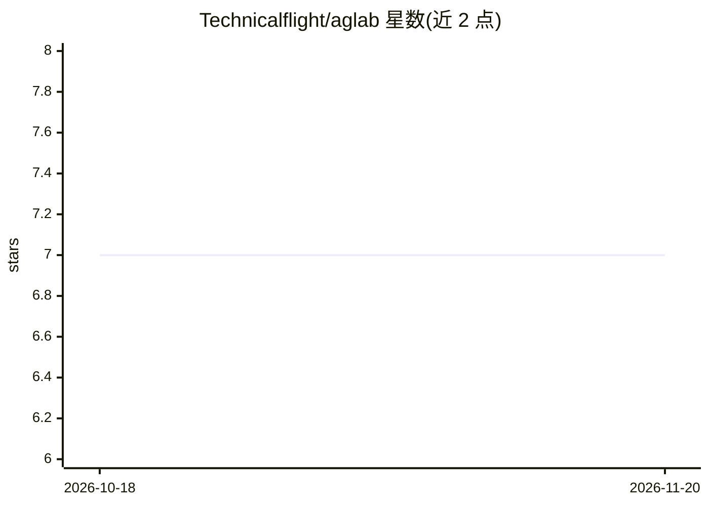

# Technicalflight/aglab

⭐ 7 · Rust · AGPL-3.0 · 推送 2026-10-12 · [GitHub](https://github.com/Technicalflight/aglab) · [官网](https://technicalflight.github.io/aglab-site/) · 个人维护 · 中文 README

**Windows 桌面端 AI 编程助手：接入自有服务商读码、跑命令、改文件**

基于 Tauri 2 + React 19 + Rust 的 Windows 桌面应用，模型服务商由用户自定（OpenAI 兼容协议、多档案与模型池路由），模型在指定工作目录内读取代码、执行命令、修改文件；工具调用带沙箱收容、规则库与审批、审计中心与敏感打码、删除进回收站与备份。除对话外提供生图、视频、音乐、语音合成与转写等独立能力会话，支持多模态识别、MCP 服务器接入、目标模式自主推进、定时任务、记忆蒸馏与本地知识库检索。安装包未做代码签名。

## 筛选速览

| 维度 | 判定 | 备注 |
|---|---|---|
| AI 角色 | `ai-native` | 本体是模型或模型工具 |
| 许可风险 | `dual` | AGPL-3.0 |
| 部署形态 | `desktop` | 安装包/桌面程序 |
| 模型依赖 | — | README 未给出锁定关系 |
| 硬件要求 | — | 无带数字的原话,不猜 |
| 安装摩擦 | `low` | 无编译、无系统依赖或容器化 |
| 成熟度 | — | 结构信号不足 |

## 能力要点

- OpenAI 兼容多服务商档案与模型池路由
- 工具调用逐次沙箱收容 + 规则库审批 + 审计中心
- 生图/视频/音乐/语音四类独立能力会话与多模态识别
- MCP（stdio/HTTP、OAuth）、目标模式、记忆蒸馏与本地知识库

## 适用场景

- 在 Windows 桌面上用自选模型对指定工作目录读写代码、执行命令
- 用同一客户端生成图片、视频、音乐或做多模态识别
- 给一个目标让模型按判据清单自主推进并强制修复
- 通过 MCP 与技能、SSH、LSP、浏览器控制扩展助手能力

## 场景标签

`编码 Agent` `图像生成` `视频生成` `语音合成` · 领域:编码与开发

## 证据(README 行号)

> L5: **一个跑在你桌面上的 AI 编程助手（Windows）**
> L20: aglab 是一个 Windows 桌面端的 AI 编程助手：模型从你来定（任何 OpenAI 兼容协议的服务商，多档案 + 模型池路由），活儿在你的工作目录里干——读代码、执行命令、改文件，每一步都有规则库、审批与审计兜底。
> L22: 它不只是一个聊天窗口：对话、生图、视频、音乐是四类各自独立的能力会话；模型看不懂的东西可以喂给它看（图片/视频/音频多模态识别）；长对话自动压缩，关键结论沉淀进记忆与知识库。

## 星数曲线

2026-10-18 7 → 2026-11-20 7（+0）

---
*卡片 v1 · prompt 1.4 · 生成 2026-11-20 · 置信度 high · 依据 README sha `38921ec86d54` · [字段定义](../../DATASET.md)*
