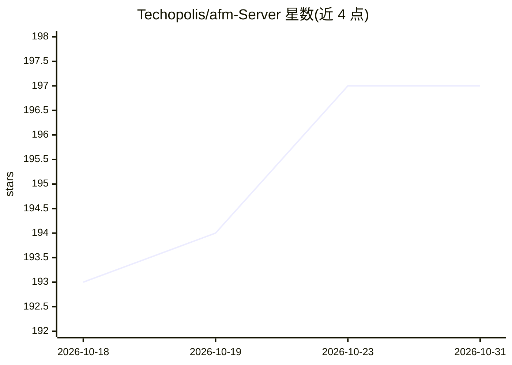

# Techopolis/afm-Server

⭐ 197 · Swift · MIT · 推送 2026-06-02 · [GitHub](https://github.com/Techopolis/afm-Server) · [官网](https://github.com/Techopolis-Online/Perspective-Intelligence) · 个人维护

**把 Apple 本地 Foundation Models 暴露为 OpenAI/Ollama 兼容 API 的 macOS 菜单栏应用**

macOS 菜单栏应用，在本地启动 HTTP 服务器（默认端口 11435），将 Apple Intelligence 的设备端 Foundation Models 封装为 OpenAI 与 Ollama 兼容的 API 端点，支持 SSE 流式输出、多轮会话缓存（30 分钟 TTL、最多 50 会话）、并发信号量（默认 3）、护栏拒绝恢复与 OpenAI 兼容工具调用（客户端委派与服务器本地 bash/文件工具两条路径）。要求 macOS 26、Apple Silicon（M1 起）与开启 Apple Intelligence，处理全部在设备端完成。提供签名公证的下载包，也可从源码构建，README 给出 Xcode 26、Cursor、Continue.dev 等客户端接入配置。

## 筛选速览

| 维度 | 判定 | 备注 |
|---|---|---|
| AI 角色 | `ai-ecosystem` | LLM/agent 周边工具 |
| 许可风险 | `permissive` | MIT |
| 部署形态 | `desktop` | 安装包/桌面程序 |
| 模型依赖 | local-ok | 支持本地模型 |
| 硬件要求 | — | 无带数字的原话,不猜 |
| 安装摩擦 | `medium` | 含编译或系统依赖之一 |
| 成熟度 | — | 结构信号不足 |

## 能力要点

- OpenAI 与 Ollama 双兼容端点，SSE 逐 token 流式输出
- 会话缓存（30 分钟 TTL、50 会话上限）与护栏拒绝后的会话自动恢复
- OpenAI 兼容工具调用：客户端委派工具与服务器本地 bash/文件工具
- 设备端推理，数据不离开本机

## 适用场景

- 让 Xcode/Cursor/Continue 等仅支持 OpenAI 或 Ollama API 的工具使用 Apple 本地模型
- 在 Mac 上离线运行兼容 OpenAI 格式的本地推理服务
- 为 agent 框架提供带工具调用的本地模型后端

## 场景标签

`推理引擎` · 领域:训练与推理

## 证据(README 行号)

> L3: A macOS menu bar application that bridges Apple Intelligence (on-device Foundation Models) with OpenAI and Ollama-co
> L10: - **OpenAI API Compatible**: Drop-in replacement for OpenAI API clients
> L11: - **Ollama API Compatible**: Works with applications that support Ollama

## 星数曲线

2026-10-18 193 → 2026-10-31 197（+4）

---
*卡片 v1 · prompt 1.4 · 生成 2026-10-22 · 置信度 high · 依据 README sha `368369194ec3` · [字段定义](../../DATASET.md)*
