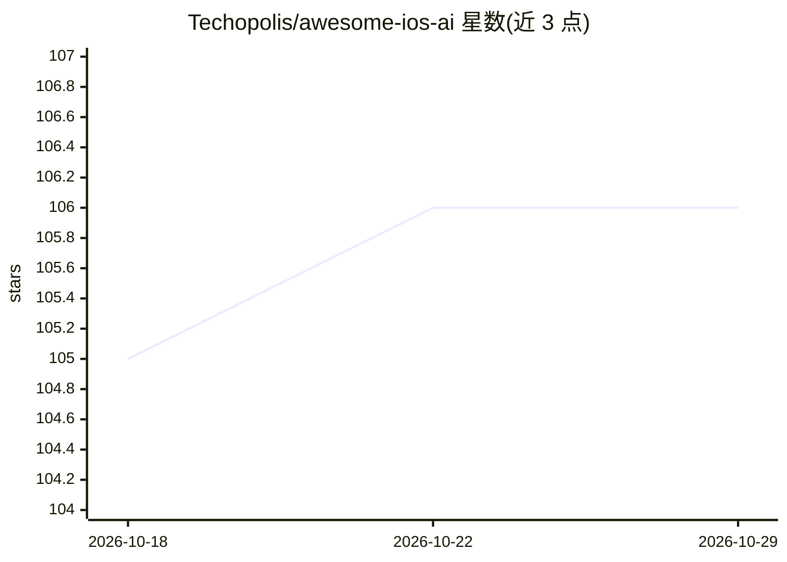

# Techopolis/awesome-ios-ai

⭐ 106 · Shell · CC0-1.0 · 推送 2026-04-25 · [GitHub](https://github.com/Techopolis/awesome-ios-ai) · 组织维护

**iOS/Swift 开发的 AI agent 技能与 MCP 工具策展清单**

面向 Swift 与 iOS 开发者的 awesome 清单：收录 agent skills、agent 团队、MCP 服务器与工具，用于让 AI 编码助手掌握 SwiftUI、并发、架构、测试、Core Data 等领域的专业知识。技能遵循开放标准，跨 GitHub Copilot、Claude Code、Cursor、Codex 等工具使用，可经 skills CLI（npx skills add）安装。条目覆盖无障碍、WidgetKit、WebAssembly、App Store 工作流等类别，并附 MCP 服务器与资源链接。由 Taylor Arndt 创建、Techopolis 维护。

## 筛选速览

| 维度 | 判定 | 备注 |
|---|---|---|
| AI 角色 | `ai-knowledge` | 知识聚合/清单类 |
| 许可风险 | `viral` | CC0-1.0 |
| 部署形态 | `library` | 以包/库形式分发 |
| 模型依赖 | — | README 未给出锁定关系 |
| 硬件要求 | — | 无带数字的原话,不猜 |
| 安装摩擦 | `medium` | 含编译或系统依赖之一 |
| 成熟度 | — | 结构信号不足 |

## 能力要点

- 收录 SwiftUI、并发、架构、测试等类别的 agent skills，跨 Copilot/Claude Code/Cursor/Codex 使用
- 列有 XcodeBuildMCP、Apple Docs MCP 等 iOS 开发 MCP 服务器
- 含十六个编排专家的 Swift Agents 与 Copilot for Xcode 工具
- 提供 skills CLI 安装命令与技能规范等资源链接

## 适用场景

- 为 AI 编码助手挑选 Swift/iOS 领域技能
- 查找能构建、测试、调试 Xcode 项目的 MCP 服务器
- 了解 AI 辅助 iOS 开发的技能与工具生态

## 场景标签

`精选清单` · 领域:学习与行业

## 证据(README 行号)

> L1: # Awesome iOS AI Awesome
> L3: > Making AI coding assistants experts at Swift and iOS development.
> L9: ## Skills

## 星数曲线

2026-10-18 105 → 2026-10-29 106（+1）

---
*卡片 v1 · prompt 1.4 · 生成 2026-10-23 · 置信度 high · 依据 README sha `538e43806fc4` · [字段定义](../../DATASET.md)*
