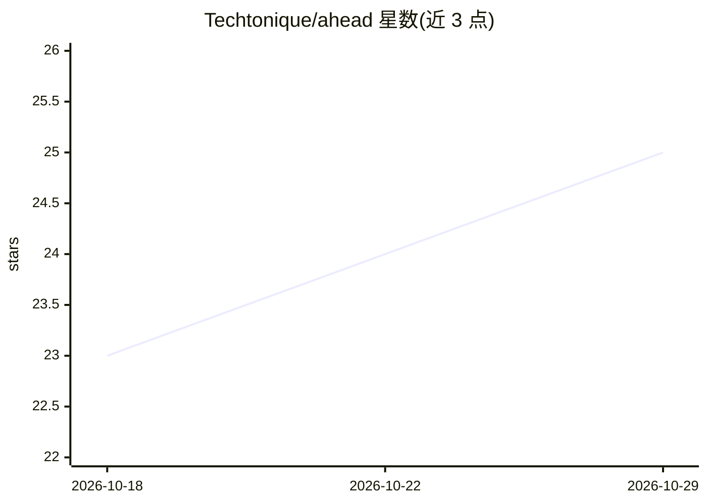

# Techtonique/ahead

⭐ 25 · R · BSD-3-Clause-Clear · 推送 2026-10-18 · [GitHub](https://github.com/Techtonique/ahead) · [官网](https://techtonique.github.io/ahead/) · 个人维护

**R 包：单变量与多变量时间序列预测，含量化不确定性**

Techtonique 维护的 R 时间序列预测库（描述称支持 Python），提供 dynrmf 等动态机器学习预测函数，可搭配 Random Forest、Support Vector Machines 等回归器做单变量预测；提供 ridge2f 基于拟随机化函数连接神经网络的模型（Moudiki 等 2018 年论文）做多变量预测，并输出预测均值与不确定性量化。安装途径为 Techtonique 的 R 仓库或 GitHub（devtools）。README 含 R 代码示例与 BSD 3-Clause 许可声明。

## 筛选速览

| 维度 | 判定 | 备注 |
|---|---|---|
| AI 角色 | `ai-native` | 本体是模型或模型工具 |
| 许可风险 | `viral` | BSD-3-Clause-Clear |
| 部署形态 | `None` |  |
| 模型依赖 | — | README 未给出锁定关系 |
| 硬件要求 | — | 无带数字的原话,不猜 |
| 安装摩擦 | `low` | 无编译、无系统依赖或容器化 |
| 成熟度 | — | 结构信号不足 |

## 能力要点

- dynrmf 支持搭配 Random Forest / SVM 的单变量动态预测
- ridge2f 基于拟随机化函数连接神经网络做多变量预测
- 提供不确定性量化
- 支持 R 包仓库与 GitHub 两种安装方式

## 适用场景

- 对单变量时间序列做动态机器学习预测
- 对多变量时间序列做带不确定性的预测
- 保险等多元数据集的预测分析示例

## 场景标签

 · 领域:统计学习/时间序列预测

## 证据(README 行号)

> L3: Univariate and multivariate time series forecasting, with uncertainty quantification.
> L36: ##### 1 - 1 Example 1: with `dynrmf` (type `?dynrmf` in R console for more details) and Random Forest
> L60:  Moudiki, T., Planchet, F., & Cousin, A. (2018).

## 星数曲线

2026-10-18 23 → 2026-10-29 25（+2）

---
*卡片 v1 · prompt 1.4 · 生成 2026-10-27 · 置信度 high · 依据 README sha `31f2683df9f8` · [字段定义](../../DATASET.md)*
