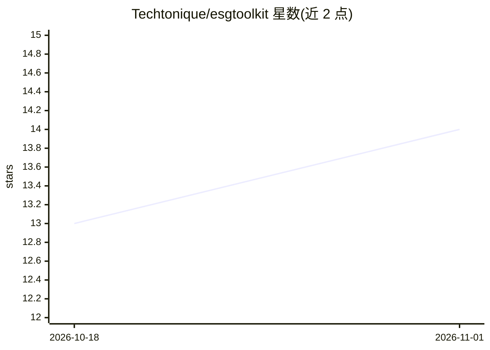

# Techtonique/esgtoolkit

⭐ 14 · HTML · BSD-3-Clause-Clear · 推送 2026-05-16 · [GitHub](https://github.com/Techtonique/esgtoolkit) · [官网](https://techtonique.github.io/ESGtoolkit/) · 个人维护

**金融/经济/保险/物理领域的随机模拟工具包（R）**

R 语言工具包，用于金融、经济、保险、物理领域的蒙特卡洛模拟：通过组合包内提供的构件（随机微分方程、扩散过程等）构建多种模拟模型，支持几何布朗运动等过程，服务于情景生成与情景分析。自 1.0.0 版本起包名统一为小写 esgtoolkit，作者同时宣布将该包从 CRAN 移除、改由自建 Techtonique R 仓库分发。许可证为 BSD 3-Clause Clear。提供函数文档、vignette 与网站 Reference 示例代码。

## 筛选速览

| 维度 | 判定 | 备注 |
|---|---|---|
| AI 角色 | `ai-enhanced` | 去掉 AI 部分产品仍成立 |
| 许可风险 | `viral` | BSD-3-Clause-Clear |
| 部署形态 | `None` |  |
| 模型依赖 | — | README 未给出锁定关系 |
| 硬件要求 | — | 无带数字的原话,不猜 |
| 安装摩擦 | `low` | 无编译、无系统依赖或容器化 |
| 成熟度 | — | 结构信号不足 |

## 能力要点

- 通过组合构件创建多种随机模拟模型
- 覆盖金融、经济、保险、物理领域的蒙特卡洛模拟
- 支持几何布朗运动等随机过程示例
- 自 1.0.0 起包名统一为小写并从 CRAN 转向自建仓库分发

## 适用场景

- 为金融衍生品或保险负债生成随机情景
- 做经济或物理系统的蒙特卡洛模拟与情景分析
- 组合随机微分方程构件搭建自定义模拟模型

## 场景标签

`金融量化` · 领域:学习与行业

## 证据(README 行号)

> L10: A toolkit for Monte Carlo Simulations in Finance, Economics, Insurance, Physics. Multiple simulation models can be 
> L38: # Geometric Brownian Motion (https://en.wikipedia.org/wiki/Geometric_Brownian_motion)

## 星数曲线

2026-10-18 13 → 2026-11-01 14（+1）

---
*卡片 v1 · prompt 1.4 · 生成 2026-10-31 · 置信度 low · 依据 README sha `807256eeffca` · [字段定义](../../DATASET.md)*
