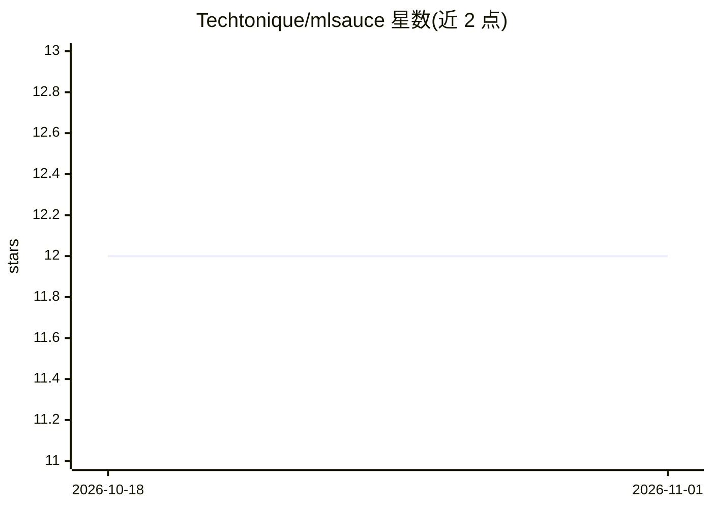

# Techtonique/mlsauce

⭐ 12 · Jupyter Notebook · BSD-3-Clause-Clear · 推送 2026-09-01 · [GitHub](https://github.com/Techtonique/mlsauce) · [官网](https://techtonique.github.io/mlsauce/) · 个人维护

**Python/R 统计与机器学习工具集合，含 LSBoost、AdaOpt 等模型**

由 Thierry Moudiki 维护的统计/机器学习杂项工具库，以 Python 与 R 双语言提供多种模型，README 提及 LSBoost（梯度提升惩罚非线性最小二乘）与 AdaOpt（多变量优化分类）等算法。Python 端支持 pip（PyPI）、GitHub 源码与 conda-forge 三种安装方式；R 端可从 GitHub 或 R-universe 安装。依赖 Numpy、Scipy、scikit-learn 与 querier，另提供 Makefile 构建的 Docker 镜像。

## 筛选速览

| 维度 | 判定 | 备注 |
|---|---|---|
| AI 角色 | `ai-native` | 本体是模型或模型工具 |
| 许可风险 | `viral` | BSD-3-Clause-Clear |
| 部署形态 | `library` | 以包/库形式分发 |
| 模型依赖 | — | README 未给出锁定关系 |
| 硬件要求 | — | 无带数字的原话,不猜 |
| 安装摩擦 | `low` | 无编译、无系统依赖或容器化 |
| 成熟度 | — | 结构信号不足 |

## 能力要点

- Python 与 R 双语言实现，共享算法集合
- 含 LSBoost 梯度提升与 AdaOpt 优化分类等模型
- 支持 pip / conda / GitHub 源码安装
- 提供 Makefile 构建与测试的 Docker 工作流

## 适用场景

- 在 Python 或 R 中使用 LSBoost 等统计学习模型
- 需要梯度提升类算法的建模任务
- 通过 Docker 容器复现包的示例与测试

## 场景标签

 · 领域:机器学习/统计计算

## 证据(README 行号)

> L5: Miscellaneous Statistical/Machine learning stuff.
> L73: Examples can be found here on GitHub. You can also read about this package here, and in particular for `LSBoost`: h

## 星数曲线

2026-10-18 12 → 2026-11-01 12（+0）

---
*卡片 v1 · prompt 1.4 · 生成 2026-11-01 · 置信度 high · 依据 README sha `3d8c371c38c2` · [字段定义](../../DATASET.md)*
