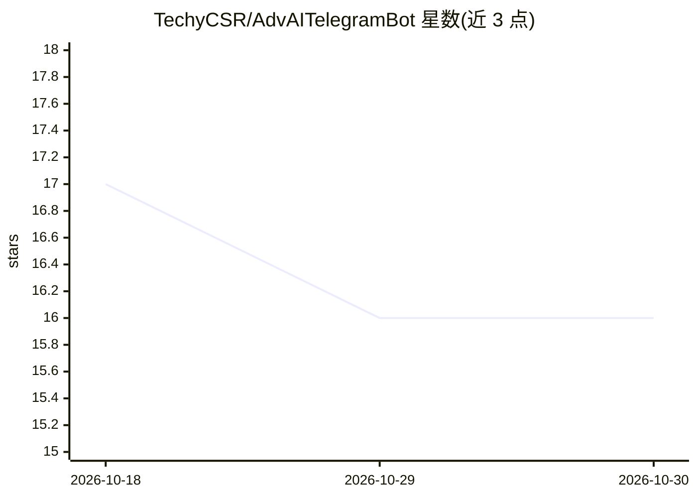

# TechyCSR/AdvAITelegramBot

⭐ 16 · Python · NOASSERTION · 推送 2026-01-18 · [GitHub](https://github.com/TechyCSR/AdvAITelegramBot) · [官网](https://t.me/AdvChatGptBot) · 个人维护

**多模型 AI Telegram 机器人：对话、视觉、图像生成与语音**

基于 Pyrogram 的 Python Telegram 机器人，接入 GPT-4o、DeepSeek、Qwen、Llama 等多个 AI 提供方，提供上下文对话、图像视觉分析与问答、文档/PDF 文本提取、文本生成图像（Flux/DALL-E/Pollinations）、AI 图像编辑、语音转文字与文字转语音。采用多提供方自动回退机制与 MongoDB 存储，支持群组使用、多实例隔离运行、用户管理与广播等管理功能，通过 Docker 或 systemd 部署，运行需配置 Telegram Bot Token 与自建 config.py。

## 筛选速览

| 维度 | 判定 | 备注 |
|---|---|---|
| AI 角色 | `ai-native` | 本体是模型或模型工具 |
| 许可风险 | `none` | NOASSERTION |
| 部署形态 | `self-host` | docker 或自建部署 |
| 模型依赖 | locked-api |  |
| 硬件要求 | — | 无带数字的原话,不猜 |
| 安装摩擦 | `low` | 无编译、无系统依赖或容器化 |
| 成熟度 | — | 结构信号不足 |

## 能力要点

- 多提供方模型接入与自动回退机制
- 视觉分析、文档处理与图像编辑（编辑/分析自动判别）
- 文本生图（Flux/DALL-E/Pollinations）与多语言语音转写/合成
- 多实例隔离运行与用户管理、广播、统计面板

## 适用场景

- 在 Telegram 中与多模型 AI 对话并切换模型
- 发图提问、提取文档文本或让 AI 编辑图片
- 在群组中使用 AI 并按群自定义行为

## 场景标签

`聊天机器人` `图像生成` `语音识别` `语音合成` · 领域:对话与助手

## 证据(README 行号)

> L19: Advanced AI Telegram Bot is a feature-rich, production-ready bot that leverages multiple AI providers to deliver in
> L42: - **Speech-to-Text** — Send voice messages for AI transcription and response

## 星数曲线

2026-10-18 17 → 2026-10-30 16（-1）

---
*卡片 v1 · prompt 1.4 · 生成 2026-10-30 · 置信度 high · 依据 README sha `00908a027e41` · [字段定义](../../DATASET.md)*
