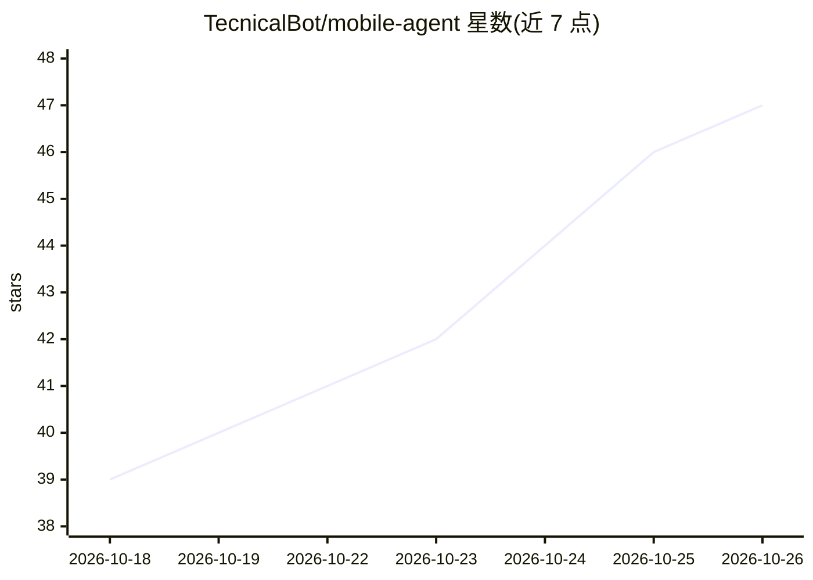

# TecnicalBot/mobile-agent

⭐ 47 · TypeScript · MIT · 推送 2026-10-24 · [GitHub](https://github.com/TecnicalBot/mobile-agent) · [官网](https://mobile-agent.vercel.app/) · 个人维护

**完全在手机端本地运行的 Android AI agent**

面向 Android 设备的开源 AI agent 应用，通过 GitHub Releases 以 APK 形式分发，安装后授予权限即可使用。模型与运行完全在设备端，无需外部服务器，可离线运行；支持 MCP、技能系统、持久记忆、多模态、语音转文字，以及基于 Android 权限直接访问手机内部存储。另声称可在不使用视频生成模型的情况下生成/编辑视频，并支持社区插件。MIT 许可。

## 筛选速览

| 维度 | 判定 | 备注 |
|---|---|---|
| AI 角色 | `ai-native` | 本体是模型或模型工具 |
| 许可风险 | `permissive` | MIT |
| 部署形态 | `desktop` | 安装包/桌面程序 |
| 模型依赖 | — | README 未给出锁定关系 |
| 硬件要求 | — | 无带数字的原话,不猜 |
| 安装摩擦 | `low` | 无编译、无系统依赖或容器化 |
| 成熟度 | — | 结构信号不足 |

## 能力要点

- 模型完全在设备端运行，无需外部服务器、可离线
- 支持 MCP、技能系统与社区插件
- 持久记忆与多模态支持
- 语音转文字与基于 Android 权限的内部存储访问

## 适用场景

- 在 Android 手机上离线运行个人 AI 助手
- 通过语音指令操作手机上的 agent
- 借助 MCP 与技能系统扩展 agent 能力

## 场景标签

`AI 助手` `GUI 自动化` · 领域:效率与自动化

## 证据(README 行号)

> L3: Mobile Agent is an open-source AI agent built specifically for mobile devices that runs entirely on your phone.
> L12: - On-device models that can run completely offline

## 星数曲线

2026-10-18 39 → 2026-10-26 47（+8）

---
*卡片 v1 · prompt 1.4 · 生成 2026-10-25 · 置信度 high · 依据 README sha `6788ce904f20` · [字段定义](../../DATASET.md)*
