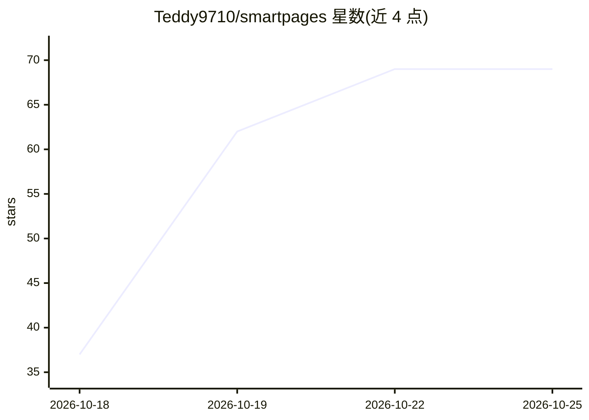

# Teddy9710/smartpages

⭐ 69 · JavaScript · GPL-3.0 · 推送 2026-10-25 · [GitHub](https://github.com/Teddy9710/smartpages) · 个人维护 · 中文 README

**把浏览器操作录制并生成文档的 Chrome 扩展**

Chrome MV3 扩展：录制点击、输入与截图，配合用户自选的 LLM 生成用户指南、教程、测试用例与缺陷报告，可编辑、标注截图后导出为 Markdown/HTML/Word/PDF 等格式。支持 OpenAI 兼容 Chat Completions（OpenAI、Gemini、GLM、DeepSeek、Kimi 等）与 Anthropic Messages API，API key 存本地。参考文档上传解析以本地为主，扫描 PDF 可选用视觉模型 OCR；Supabase 云同步默认关闭。提供 GitHub Releases 安装包与源码构建两种方式。

## 筛选速览

| 维度 | 判定 | 备注 |
|---|---|---|
| AI 角色 | `ai-native` | 本体是模型或模型工具 |
| 许可风险 | `dual` | GPL-3.0 |
| 部署形态 | `library` | 以包/库形式分发 |
| 模型依赖 | locked-api |  |
| 硬件要求 | — | 无带数字的原话,不猜 |
| 安装摩擦 | `low` | 无编译、无系统依赖或容器化 |
| 成熟度 | — | 结构信号不足 |

## 能力要点

- 录制浏览器操作与截图，生成指南/测试用例/缺陷报告
- 支持 OpenAI 兼容接口与 Anthropic Messages API，按 provider 独立配置
- 上传 TXT/PDF/DOCX 等参考文档，本地解析为主
- 可导出 .smartpages.json 工作流并通过实验性 MCP bridge 暴露给本地 agent

## 适用场景

- 把产品操作流程录制成一份图文用户指南
- 复现一次问题就生成带截图的缺陷报告
- 为 QA 生成结构化测试用例文档

## 场景标签

`AI 写作` · 领域:内容生成

## 证据(README 行号)

> L40: 2. **Generate** — choose a document goal and generate a draft with GPT, Gemini, Claude, DeepSeek, or another compat
> L103: - **OpenAI-compatible Chat Completions:** OpenAI, Gemini, GLM, DeepSeek, MiniMax, Kimi, OpenRouter, SiliconFlow, D
> L7:  Record clicks and screenshots once. Generate editable guides, tutorials,

## 星数曲线

2026-10-18 37 → 2026-10-25 69（+32）

---
*卡片 v1 · prompt 1.4 · 生成 2026-10-24 · 置信度 high · 依据 README sha `c3cdde2f0ec9` · [字段定义](../../DATASET.md)*
