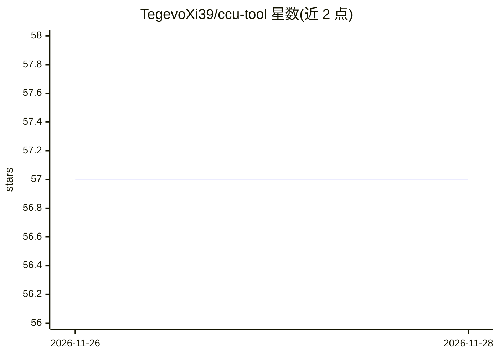

# TegevoXi39/ccu-tool

⭐ 57 · C++ · MIT · 推送 2026-11-24 · [GitHub](https://github.com/TegevoXi39/ccu-tool) · [官网](https://github.com/TegevoXi39/ccu-tool/releases) · 个人维护

**为 Claude Code CLI 自动轮换会话，绕开用量限制**

面向 Windows x64 的便携式会话轮换引擎（ccu-tool），围绕 Claude Code CLI 运行：会话自动轮换，用户工作不中断。全部行为由 config/settings.json 驱动，支持热重载配置、无需重启生效；内置带崩溃安全回滚的原子 JSON 状态引擎、零拷贝环形缓冲管线与默认静默的 stderr 遥测。官方发布为免编译的预构建 zip 包（解压密码 2026），也可从源码用 CMake 构建。

## 筛选速览

| 维度 | 判定 | 备注 |
|---|---|---|
| AI 角色 | `ai-ecosystem` | LLM/agent 周边工具 |
| 许可风险 | `permissive` | MIT |
| 部署形态 | `desktop` | 安装包/桌面程序 |
| 模型依赖 | — | README 未给出锁定关系 |
| 硬件要求 | — | 无带数字的原话,不猜 |
| 安装摩擦 | `medium` | 含编译或系统依赖之一 |
| 成熟度 | — | 结构信号不足 |

## 能力要点

- 自动轮换 Claude Code 会话，无需编译的 Windows x64 便携包
- settings.json 热重载配置，改动无需重启生效
- 原子 JSON 状态引擎，支持崩溃安全回滚
- 默认静默的 stderr 遥测通道，可用 --verbose 打开

## 适用场景

- 在 Claude Code CLI 长时间使用中避免手动处理会话限制
- Windows 10/11 上免安装即取即用地运行轮换工具
- 通过热重载配置调整轮换行为而不打断工作

## 场景标签

 · 领域:开发者工具/LLM 工作流

## 证据(README 行号)

> L3:  Claude Code Unlimited — Claude Code Unlimited — Session Rotation Engine for Claude Code CLI (One-Command Setup, Pre
> L18: **Claude Code Unlimited — Sessions rotate, you keep working** (`ccu-tool`) ships as a native 64-bit Windows build w

## 星数曲线

2026-11-26 57 → 2026-11-28 57（+0）

---
*卡片 v1 · prompt 1.4 · 生成 2026-11-26 · 置信度 high · 依据 README sha `82cf0f83f833` · [字段定义](../../DATASET.md)*
