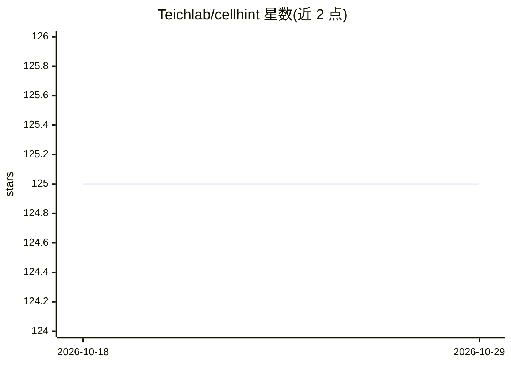

# Teichlab/cellhint

⭐ 125 · Python · MIT · 推送 2026-03-09 · [GitHub](https://github.com/Teichlab/cellhint) · 组织维护

**单细胞数据跨数据集细胞类型自动统一与整合工具**

面向单细胞 RNA 测序（AnnData 格式）分析的 Python 工具，做两件事：跨独立数据集匹配并统一各自定义的细胞类型标注（harmonisation），以及在统一标注监督下整合数据（integration）。机制上先计算细胞与细胞类型质心的转录距离，支持预测性聚类树（PCT）应对强批次效应，输出统一表、细胞重标注及高/低层级细胞类型分组。通过 pip 与 conda-forge 安装，提供 Colab 交互教程。

## 筛选速览

| 维度 | 判定 | 备注 |
|---|---|---|
| AI 角色 | `ai-native` | 本体是模型或模型工具 |
| 许可风险 | `permissive` | MIT |
| 部署形态 | `library` | 以包/库形式分发 |
| 模型依赖 | — | README 未给出锁定关系 |
| 硬件要求 | — | 无带数字的原话,不猜 |
| 安装摩擦 | `low` | 无编译、无系统依赖或容器化 |
| 成熟度 | — | 结构信号不足 |

## 能力要点

- 跨数据集细胞类型自动匹配与统一，输出含 =/∈/∋ 关系的统一表
- 可用预测性聚类树（PCT）预测跨数据集距离以应对批次效应
- 细胞重注释与高/低层级细胞类型分组
- 在统一标注监督下进行数据整合

## 适用场景

- 我有多个独立注释的单细胞数据集，想统一各家的细胞类型标注
- 把不同数据集的细胞按统一标注重新标记并分组
- 整合多数据集单细胞数据用于下游分析

## 场景标签

 · 领域:生物信息学/单细胞测序

## 证据(README 行号)

> L3: CellHint is an automated tool for cell type harmonisation and integration.
> L31:  The input AnnData needs two columns in `.obs` representing dataset origin and cell original annotation respectivel

## 星数曲线

2026-10-18 125 → 2026-10-29 125（+0）

---
*卡片 v1 · prompt 1.4 · 生成 2026-10-23 · 置信度 high · 依据 README sha `6f6f1f556160` · [字段定义](../../DATASET.md)*
