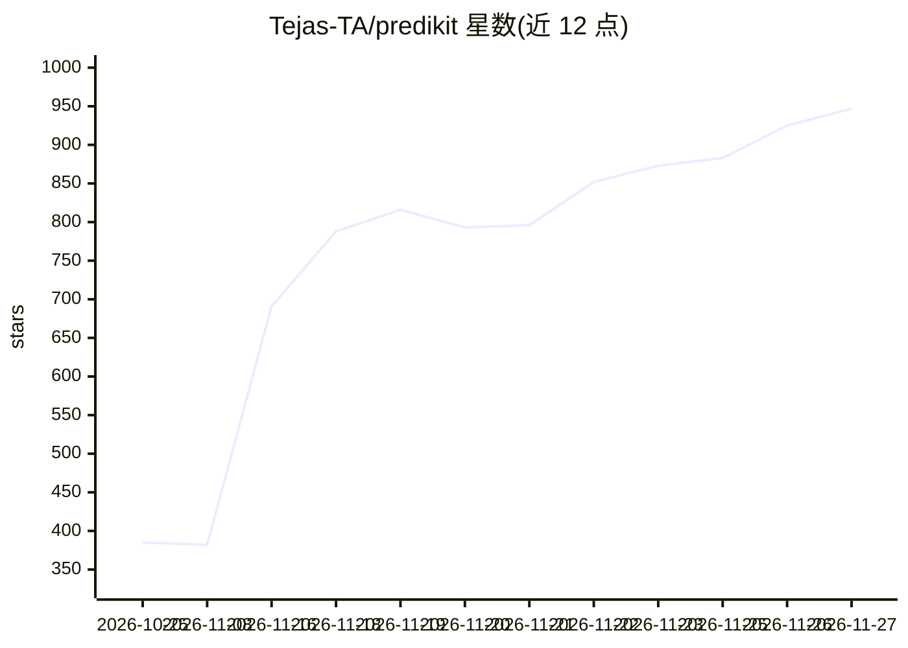

# Tejas-TA/predikit

⭐ 947 · Python · MIT · 推送 2026-11-26 · [GitHub](https://github.com/Tejas-TA/predikit) · [官网](https://pypi.org/project/predikit/) · 个人维护

**把 sklearn/XGBoost 模型包装成 LLM agent 可调用工具的 Python 库**

Python 库，将已训练的 scikit-learn 或 XGBoost 模型封装为 LLM 可调用的工具：从 Pydantic v2 模型自动生成 JSON Schema，提供 invoke/predict 与类型校验。导出接口覆盖 OpenAI function calling、LangChain StructuredTool、普通 Python callable 与 MCP server。附加能力包括多模型集成（collect/mean/vote 等 5 种策略）、置信度路由（warn/raise/fallback）、批量与异步推理，以及 MLflow/Snowflake 模型注册表加载器。限制：字段名须与训练列名完全一致；仅支持 sklearn 兼容估计器。

## 筛选速览

| 维度 | 判定 | 备注 |
|---|---|---|
| AI 角色 | `ai-ecosystem` | LLM/agent 周边工具 |
| 许可风险 | `permissive` | MIT |
| 部署形态 | `library` | 以包/库形式分发 |
| 模型依赖 | — | README 未给出锁定关系 |
| 硬件要求 | — | 无带数字的原话,不猜 |
| 安装摩擦 | `low` | 无编译、无系统依赖或容器化 |
| 成熟度 | — | 结构信号不足 |

## 能力要点

- Pydantic v2 自动生成 JSON Schema 与类型校验
- 导出为 OpenAI function schema / LangChain tool / MCP server
- ModelEnsemble 5 种集成策略与置信度路由（warn/raise/fallback）
- from_mlflow() / from_snowflake() 模型注册表加载器

## 适用场景

- 让 LLM agent 调用已有的 sklearn/XGBoost 预测模型
- 用 MCP server 把模型注册表暴露给 MCP 客户端
- 多模型并行预测并按投票/加权策略汇总结果
- 对低置信度预测路由到 fallback 模型或抛出可捕获错误

## 场景标签

 · 领域:LLM 基础设施/agent 工具集成

## 证据(README 行号)

> L3:  The bridge between your ML models and LLM agents.
> L4:  Wrap any trained scikit-learn or XGBoost model as an LLM-callable tool —
> L46: **Models** — scikit-learn · XGBoost

## 星数曲线

2026-10-25 385 → 2026-11-27 947（+562）

---
*卡片 v1 · prompt 1.4 · 生成 2026-11-27 · 置信度 high · 依据 README sha `675241e26951` · [字段定义](../../DATASET.md)*
