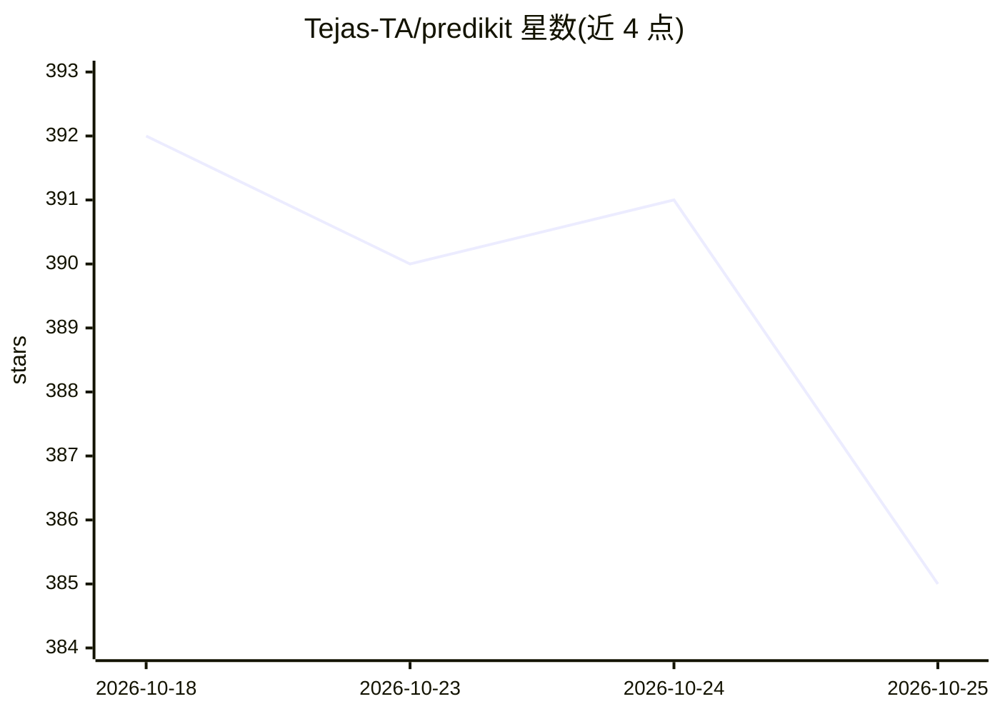

# Tejas-TA/predikit

⭐ 385 · Python · MIT · 推送 2026-09-17 · [GitHub](https://github.com/Tejas-TA/predikit) · [官网](https://pypi.org/project/predikit/) · 个人维护

**把 sklearn/XGBoost 模型封装为 LLM 可调用工具的 Python 库**

面向构建 LLM agent 工具的开发者：将训练好的 scikit-learn 或 XGBoost 模型包装为 ModelTool，自动从 Pydantic v2 模型生成 JSON Schema，通过 .to_openai()/.to_langchain() 一行导出为 OpenAI function calling 或 LangChain StructuredTool。提供 ToolRegistry 批量导出、ModelEnsemble 五种多模型聚合策略、基于 predict_proba 的置信度路由（warn/raise/fallback），以及 MLflow/Snowflake 模型注册表加载器。限制：要求 schema 字段名与训练列名精确一致；HuggingFace/PyTorch/TensorFlow 支持在规划中。

## 筛选速览

| 维度 | 判定 | 备注 |
|---|---|---|
| AI 角色 | `ai-ecosystem` | LLM/agent 周边工具 |
| 许可风险 | `permissive` | MIT |
| 部署形态 | `library` | 以包/库形式分发 |
| 模型依赖 | — | README 未给出锁定关系 |
| 硬件要求 | — | 无带数字的原话,不猜 |
| 安装摩擦 | `low` | 无编译、无系统依赖或容器化 |
| 成熟度 | — | 结构信号不足 |

## 能力要点

- 从 Pydantic BaseModel 自动生成 JSON Schema，.to_openai()/.to_langchain() 一行导出
- ModelEnsemble 提供 collect/mean/vote/weighted_mean/weighted_vote 五种聚合策略
- 置信度路由（warn/raise/fallback）与 async ainvoke()
- MLflow/Snowflake 模型注册表加载器与 MCP server 模式（stdio/Streamable HTTP）

## 适用场景

- 让 LLM agent 通过 function calling 调用已训练的传统 ML 模型
- 把多个模型组成 ensemble 并暴露为统一的 agent 工具
- 从 MLflow/Snowflake 注册表直接加载模型封装为工具

## 场景标签

`Agent 框架` · 领域:Agent 开发

## 证据(README 行号)

> L3:  The bridge between your ML models and LLM agents.
> L4:  Wrap any trained scikit-learn or XGBoost model as an LLM-callable tool —
> L36: |**LLM integration**|OpenAI / LangChain boilerplate per model|`.to_openai()` / `.to_langchain()` in one line|

## 星数曲线

2026-10-18 392 → 2026-10-25 385（-7）

---
*卡片 v1 · prompt 1.4 · 生成 2026-10-21 · 置信度 high · 依据 README sha `8023008c756a` · [字段定义](../../DATASET.md)*
