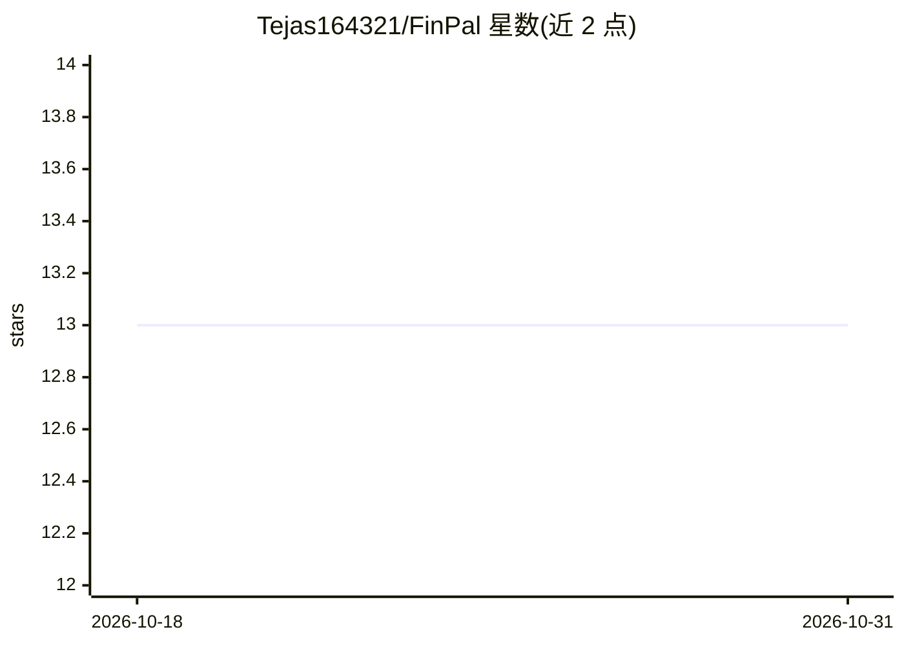

# Tejas164321/FinPal

⭐ 13 · TypeScript · 推送 2026-10-26 · [GitHub](https://github.com/Tejas164321/FinPal) · [官网](https://finpal.tejasfolio.in) · 个人维护

**面向印度 UPI 用户的个人财务看板应用**

React + Vite + TailwindCSS 构建的个人财务管理 Web 应用：上传并解析 GPay、PhonePe 及银行账单（CSV/PDF/Excel）的交易记录，提供支出看板、预算管理与 SIP/FD 投资收益模拟。分类采用规则引擎 + Google Gemini AI 回退的混合机制，另有 AI 洞察页（标注为待开发占位页）。前端为完整实现的首页与仪表盘，部分页面（交易、预算、AI 洞察、投资）仍为占位，账单上传等后端集成列为未来计划。

## 筛选速览

| 维度 | 判定 | 备注 |
|---|---|---|
| AI 角色 | `ai-enhanced` | 去掉 AI 部分产品仍成立 |
| 许可风险 | `none` | — |
| 部署形态 | `library` | 以包/库形式分发 |
| 模型依赖 | — | README 未给出锁定关系 |
| 硬件要求 | — | 无带数字的原话,不猜 |
| 安装摩擦 | `low` | 无编译、无系统依赖或容器化 |
| 成熟度 | — | 结构信号不足 |

## 能力要点

- 解析 GPay/PhonePe/银行账单（CSV/PDF/Excel）的交易记录
- 规则分类 + Google Gemini 回退的混合交易归类
- SIP 与 FD 投资收益模拟（复利公式）
- 预算管理含实时提醒与进度跟踪

## 适用场景

- 上传 UPI 交易记录查看收支与储蓄总览
- 设置分类预算并跟踪消费进度
- 用 SIP/FD 计算器模拟投资收益

## 场景标签

 · 领域:金融科技/个人理财

## 证据(README 行号)

> L14: - **AI-Powered Categorization**: Hybrid system using rule-based classification + Google Gemini AI fallback
> L50: #### 3. Placeholder Pages (Ready for Development)
> L54: - **AI Insights** (`/ai-insights`): Gemini-powered analysis and chat

## 星数曲线

2026-10-18 13 → 2026-10-31 13（+0）

---
*卡片 v1 · prompt 1.4 · 生成 2026-10-31 · 置信度 mid · 依据 README sha `3cd95abe6ecf` · [字段定义](../../DATASET.md)*
