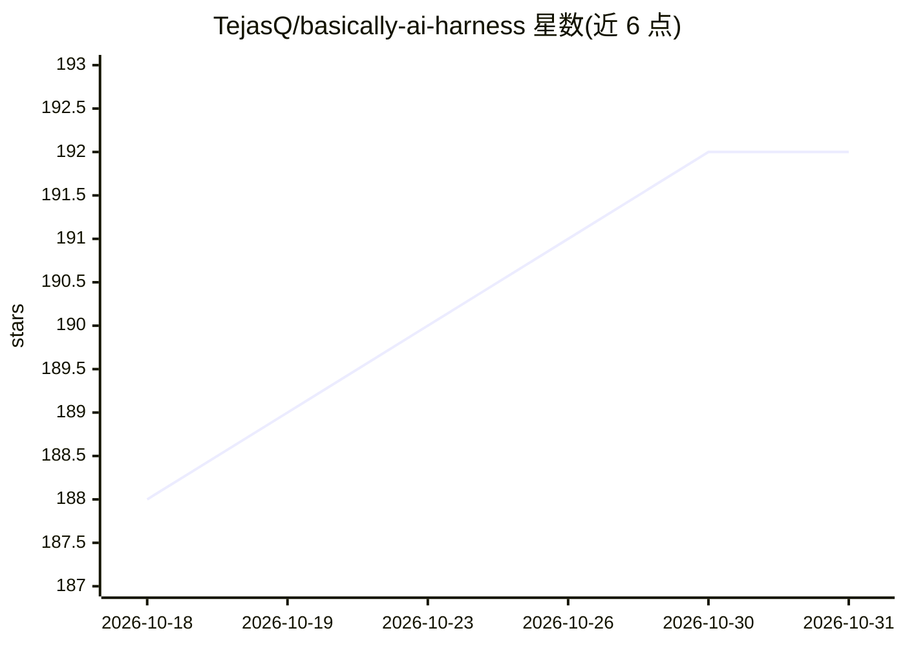

# TejasQ/basically-ai-harness

⭐ 192 · TypeScript · MIT · 推送 2026-09-15 · [GitHub](https://github.com/TejasQ/basically-ai-harness) · [官网](https://tej.as/blog/what-is-an-agent-harness) · 个人维护

**教学用 TypeScript 最小实现：评测 harness 与 agent harness 各一套**

配套 Tejas Kumar 在 AI Engineer Europe 2026 演讲的代码库，按步骤分支从零构建两类 AI harness。eval/ 部分实现固定数据集→模型→打分器→通过率流水线，用陷阱题对比多模型；agent/ 部分实现工具注册、上下文裁剪、护栏、循环与结果校验，harness 负责浏览器环境的打开与关闭。模型通过 OpenRouter 调用（OpenAI SDK），换模型只改一个字符串。README 同时讲解 harness engineering 概念与 eval/agent 两种含义的差异。

## 筛选速览

| 维度 | 判定 | 备注 |
|---|---|---|
| AI 角色 | `ai-ecosystem` | LLM/agent 周边工具 |
| 许可风险 | `permissive` | MIT |
| 部署形态 | `library` | 以包/库形式分发 |
| 模型依赖 | locked-api |  |
| 硬件要求 | — | 无带数字的原话,不猜 |
| 安装摩擦 | `low` | 无编译、无系统依赖或容器化 |
| 成熟度 | — | 结构信号不足 |

## 能力要点

- eval 与 agent 两类 harness 的逐文件最小实现
- harness 拥有环境生命周期：开浏览器、绑定工具、跑循环、校验、关闭
- 护栏拦结构性失败，verify 步骤拦语义错误的双层设计
- 对比演示：用工具的模型与跳过工具产生幻觉的模型并排输出

## 适用场景

- 学习 agent harness 的内部结构与各组件职责
- 按分支逐步跟做，理解 harness engineering 实践
- 演示护栏与校验步骤各自能拦截哪类失败

## 场景标签

`教程课程` `模型评测` · 领域:评测与运维

## 证据(README 行号)

> L3: A minimal TypeScript implementation of two kinds of AI harness, built for a talk on **harness engineering** at AI En
> L55: ```
> L57: agent/       ← the agent harness (newer meaning)

## 星数曲线



2026-10-18 188 → 2026-10-31 192（+4）


---
*卡片 v1 · prompt 1.4 · 生成 2026-10-23 · 置信度 high · 依据 README sha `0d67cfabc1a0` · [字段定义](../../DATASET.md)*
