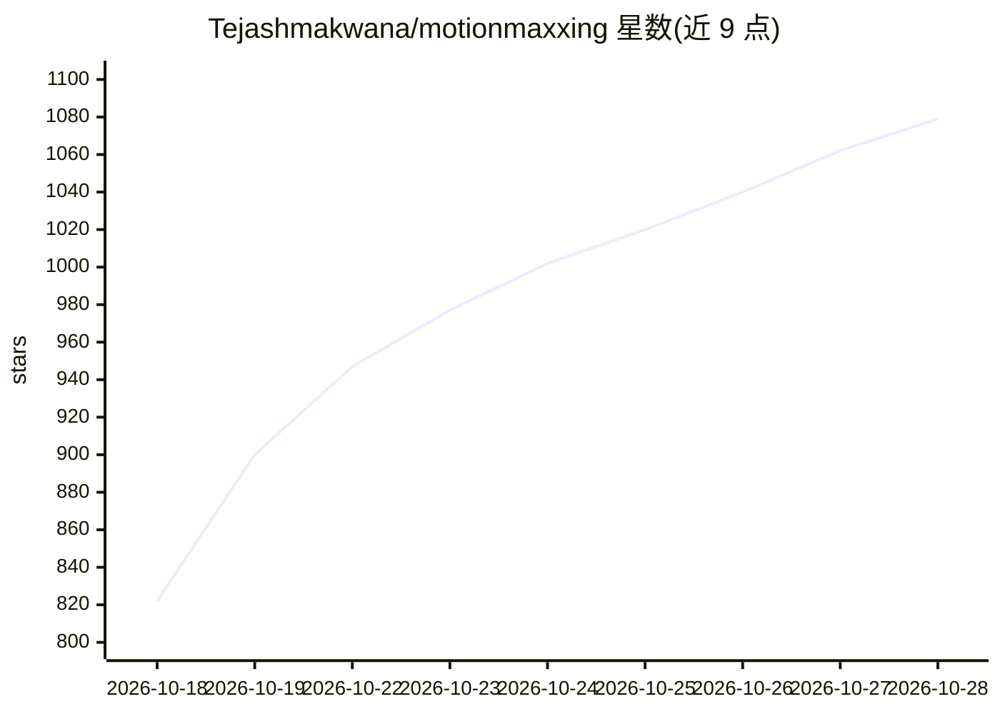

# Tejashmakwana/motionmaxxing

⭐ 1,079 · JavaScript · Apache-2.0 · 推送 2026-10-06 · [GitHub](https://github.com/Tejashmakwana/motionmaxxing) · 个人维护

**让 AI agent 产出有设计感动效影片的技能包，含量化检查门**

一个 agent skill（SKILL.md 形式），运行于 Claude Code 及任何读取 SKILL.md 文件夹的 agent，用于制作发布影片、产品宣传、品牌短打与动态字体作品。机制：抓取网站品牌信息，基于从 53 个专业动效时刻解码出的约 150 条设计师规则与 12 种实测缓动曲线逐帧定时，本地从纯 HTML 渲染，再用脚本化门禁（G0-G5，如 lint.mjs 页面残留检查、look.py 死帧检测）以数值验证成片。需要 Node 22+、Chrome 与 ffmpeg；语音功能需 ElevenLabs key。README 自述为早期版本。Apache-2.0 许可。

## 筛选速览

| 维度 | 判定 | 备注 |
|---|---|---|
| AI 角色 | `ai-ecosystem` | LLM/agent 周边工具 |
| 许可风险 | `permissive` | Apache-2.0 |
| 部署形态 | `None` |  |
| 模型依赖 | — | README 未给出锁定关系 |
| 硬件要求 | — | 无带数字的原话,不猜 |
| 安装摩擦 | `medium` | 含编译或系统依赖之一 |
| 成熟度 | `idea` | |

## 能力要点

- 基于 53 个专业动效时刻解码出的约 150 条 WHEN/DO/BECAUSE 规则与 12 种实测缓动
- 脚本化门禁 G0-G5：渲染存在性、死帧、尾卡时长、页面残留 lint 等量化检查
- 本地从纯 HTML 渲染，无需外部渲染服务
- 以 SKILL.md agent skill 形式提供，兼容 Claude Code 等 agent

## 适用场景

- 让 coding agent 为我的产品做出看起来像设计师操刀的宣传短片
- 把 AI 生成的粗糙动效视频按量化规则检查并修正
- 为品牌制作动效字体与品牌短打影片

## 场景标签

`视频生成` · 领域:内容生成

## 证据(README 行号)

> L25: Your AI video is mid. Not broken, not ugly, just undecided: a label in the corner, a headline on the left, a card o
> L9: An agent skill that turns AI slop videos into films that look made by a motion designer.

## 星数曲线

2026-10-18 822 → 2026-10-28 1,079（+257）

---
*卡片 v1 · prompt 1.4 · 生成 2026-10-21 · 置信度 high · 依据 README sha `e5655ccb82a4` · [字段定义](../../DATASET.md)*
