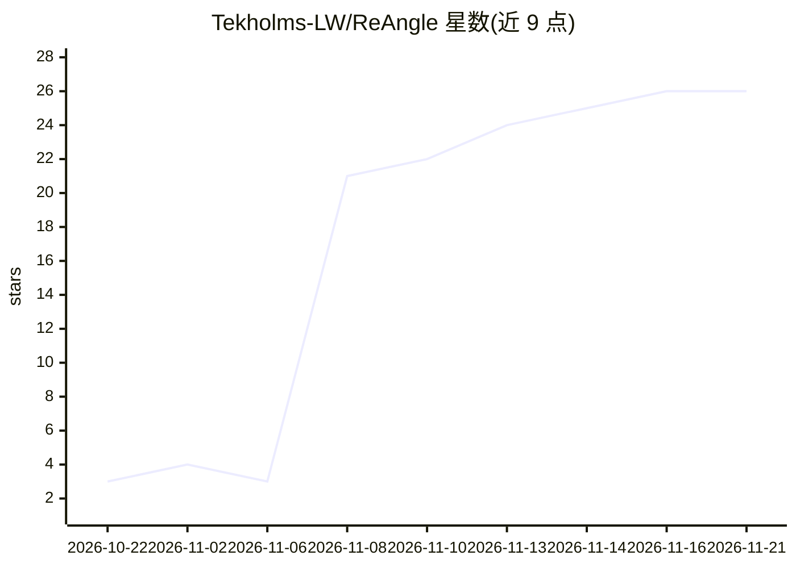

# Tekholms-LW/ReAngle

⭐ 26 · Python · Apache-2.0 · 推送 2026-10-17 · [GitHub](https://github.com/Tekholms-LW/ReAngle) · [官网](https://tekholms-lw.github.io/ReAngle/) · 个人维护

**开源视频重拍摄工具：从新机位角度重渲染任意视频**

上传视频片段后，可在片段自身的 3D 空间中绘制或选择预设相机路径（环绕/推拉/升降等），通过 Video Depth Anything 深度估计与 z-buffer 重投影生成引导图，交由 LTX-2.5（GGUF 量化）+ Layout-to-Render IC-LoRA 重新渲染出新视角的画面，并做背景感知补洞、分块防漂移与音频回填。以 FastAPI 后端 + Vite/three.js 前端 + ComfyUI 节点包形式提供，需 12–16 GB 以上 NVIDIA GPU，也可在 Comfy Cloud 付费运行。

## 筛选速览

| 维度 | 判定 | 备注 |
|---|---|---|
| AI 角色 | `ai-native` | 本体是模型或模型工具 |
| 许可风险 | `permissive` | Apache-2.0 |
| 部署形态 | `library` | 以包/库形式分发 |
| 模型依赖 | — | README 未给出锁定关系 |
| 硬件要求 | `gpu-8g` | |
| 安装摩擦 | `medium` | 含编译或系统依赖之一 |
| 成熟度 | — | 结构信号不足 |

## 能力要点

- 首帧提升为深度网格后可在 3D 空间绘制相机路径（含关键帧与实时预览）
- 深度重投影 + IC-LoRA 引导的 LTX-2.5 新视角视频生成
- 背景感知补洞与分块交叉淡入防漂移（LAB 色彩匹配）
- 本地 16 GB 显卡可运行，或经 API key 走 Comfy Cloud 托管后端

## 适用场景

- 把已拍好的视频换一个机位重新呈现（如 12° 环绕镜头）
- 为短视频生成 9:16 竖版对比或擦除式导出
- 无本地 GPU 时用 Comfy Cloud 付费额度完成重拍摄

## 场景标签

`视频生成` · 领域:内容生成

## 证据(README 行号)

> L9: ReAngle is a clean-room, open-source take on "re-shoot a video": upload a clip, pick a camera move or draw your own 
> L26:      ─► LTX-2.5 distilled (GGUF) + Layout-to-Render IC-LoRA guide (attention-masked)
> L86: Headless: `python scripts/comfy_run.py workflows/ltx25_reshoot_api.json --set video=clip.mp4 --set angle_deg=12`.

## 星数曲线

2026-10-22 3 → 2026-11-21 26（+23）

---
*卡片 v1 · prompt 1.4 · 生成 2026-11-18 · 置信度 mid · 依据 README sha `8ac01a373282` · [字段定义](../../DATASET.md)*
