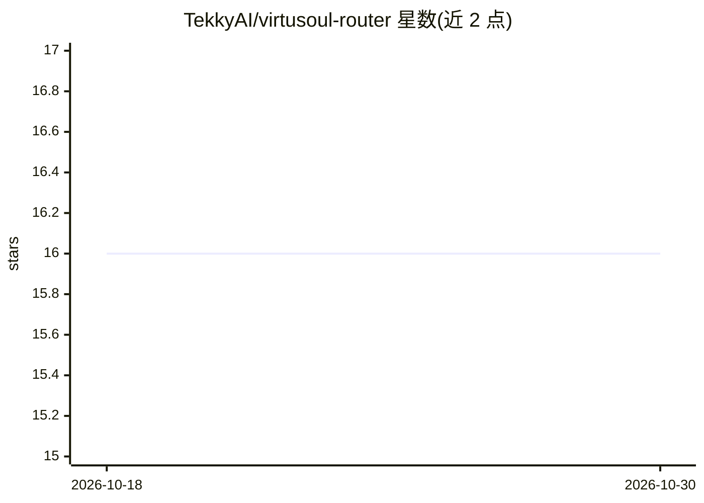

# TekkyAI/virtusoul-router

⭐ 16 · Python · MIT · 推送 2026-02-16 · [GitHub](https://github.com/TekkyAI/virtusoul-router) · 组织维护

**自托管 LLM 智能路由代理：按查询复杂度自动分发到不同模型**

自托管的 OpenAI 兼容 LLM 代理服务器：接收 /v1/chat/completions 请求，用本地 ML 分类器（all-MiniLM-L6-v2 嵌入 + Logistic Regression，CPU 上 10-20ms）将查询分为 simple/medium/complex/reasoning 四档，并路由到对应配置的模型，也可通过指定 model 直接选档。支持 OpenAI、Anthropic、Ollama 等 9 个提供商及任意 OpenAI 兼容自定义 API；提供 SSE 流式、可选 Bearer 鉴权、分类置信度低于 0.60 时标记 flagged。分类器在 200+ 样本上交叉验证准确率约 81%，可通过 /retrain 接口用内置数据重训。单进程运行，无需数据库或 Redis。

## 筛选速览

| 维度 | 判定 | 备注 |
|---|---|---|
| AI 角色 | `ai-ecosystem` | LLM/agent 周边工具 |
| 许可风险 | `permissive` | MIT |
| 部署形态 | `self-host` | docker 或自建部署 |
| 模型依赖 | local-ok | 支持本地模型 |
| 硬件要求 | — | 无带数字的原话,不猜 |
| 安装摩擦 | `low` | 无编译、无系统依赖或容器化 |
| 成熟度 | — | 结构信号不足 |

## 能力要点

- 本地 ML 分类器（MiniLM + Logistic Regression）判定 4 个复杂度档，无 LLM 调用
- OpenAI 兼容 API，改 base_url 即可接入任意 OpenAI SDK
- 9 个内置提供商 + 自定义 OpenAI 兼容 API，各档独立配置
- 预置 Docker 镜像（含模型权重）与 /classify、/retrain、/health 端点

## 适用场景

- 简单查询走便宜模型、复杂查询走强模型以控制成本
- 应用不改 SDK，仅改 base_url 即接入多提供商模型
- 本地 Ollama 搭建全自动分档的私有路由服务

## 场景标签

`模型网关` · 领域:Agent 开发

## 证据(README 行号)

> L15: VirtuSoul Router is an open-source, self-hosted LLM proxy that **automatically routes your prompts to the right mod
> L23: **No LLM calls for classification** — uses a local ML model (MiniLM + Logistic Regression) that classifies in ~15ms
> L164: VirtuSoul Router supports these providers out of the box:

## 星数曲线

2026-10-18 16 → 2026-10-30 16（+0）

---
*卡片 v1 · prompt 1.4 · 生成 2026-10-30 · 置信度 high · 依据 README sha `277ebb731584` · [字段定义](../../DATASET.md)*
