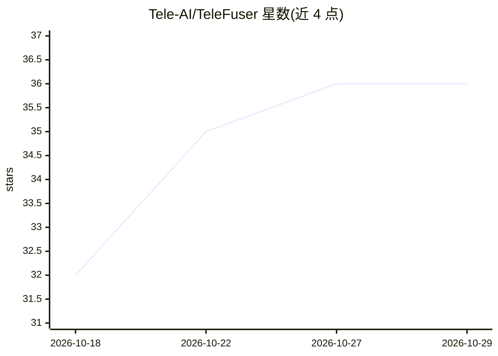

# Tele-AI/TeleFuser

⭐ 36 · Python · Apache-2.0 · 推送 2026-09-26 · [GitHub](https://github.com/Tele-AI/TeleFuser) · [官网](https://tele-ai.github.io/TeleFuser/) · 组织维护 · 中文 README

**世界模型与多模态生成的实时流式推理服务框架**

面向实时世界模型与多模态生成的开源流式推理与服务框架：提供连续视频生成、有状态会话、双向控制、LiveKit WebRTC 流式传输、FastAPI 任务服务与多 GPU 分布式执行（张量/序列并行、Triton 内核、量化、offload、潜变量缓存）。支持 LingBot-World v2、LingBot-VLA v2、Wan2.1/2.2、LTX、MiniMax H3 等模型的管线，并提供 CLI（telefuser serve / stream-serve）与 OpenAI 兼容图像/视频 API。基准验证基于 4×H100 80GB 配置，实时流式栈需另装 LiveKit Server 与 coturn。

## 筛选速览

| 维度 | 判定 | 备注 |
|---|---|---|
| AI 角色 | `ai-ecosystem` | LLM/agent 周边工具 |
| 许可风险 | `permissive` | Apache-2.0 |
| 部署形态 | `library` | 以包/库形式分发 |
| 模型依赖 | — | README 未给出锁定关系 |
| 硬件要求 | — | 无带数字的原话,不猜 |
| 安装摩擦 | `medium` | 含编译或系统依赖之一 |
| 成熟度 | — | 结构信号不足 |

## 能力要点

- 有状态流式会话与双向控制（LiveKit WebRTC）
- 多 GPU 分布式执行：张量并行、序列并行、可选 Ray worker
- Triton 内核、量化、offload、CacheSeek 潜变量缓存等推理优化栈
- 支持 LingBot-World v2 / LingBot-VLA v2 / Wan2.x / LTX / MiniMax H3 等管线

## 适用场景

- 交互式世界模型的实时流式生成与浏览器控制
- T2V/I2V 视频生成批推理与 API 服务化部署
- 语音驱动数字人与流式视频超分/复原系统搭建
- VLA 机器人视觉-语言-动作模型的推理服务

## 场景标签

`视频生成` `推理引擎` `多模态` · 领域:内容生成

## 证据(README 行号)

> L12: TeleFuser is an open-source streaming inference and serving framework for real-time world models and multimodal
> L70: - **Unified serving**: Local Python API, `telefuser serve` for task APIs, and `telefuser stream-serve` for LiveKit

## 星数曲线

2026-10-18 32 → 2026-10-29 36（+4）

---
*卡片 v1 · prompt 1.4 · 生成 2026-10-25 · 置信度 high · 依据 README sha `9c310505e3b9` · [字段定义](../../DATASET.md)*
