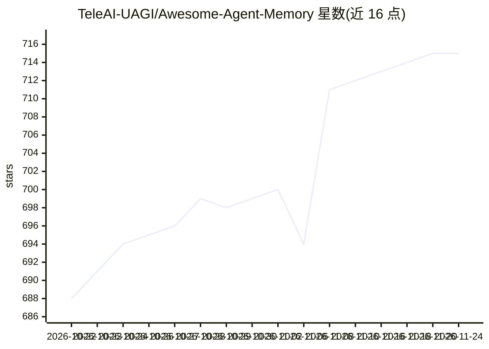

# TeleAI-UAGI/Awesome-Agent-Memory

⭐ 718 · Python · Apache-2.0 · 推送 2026-11-23 · [GitHub](https://github.com/TeleAI-UAGI/Awesome-Agent-Memory) · 组织维护 · 中文 README

**LLM/多模态智能体记忆领域的系统、基准与论文策展清单**

由 Bloo-Mind AI 与 TeleAI 的 Ubiquitous AGI 团队维护的 awesome 类策展清单，收录面向 LLM 与多模态智能体的记忆系统、基准测试与研究论文，覆盖长期上下文、检索与推理。条目按类别组织为产品、教程、综述、基准（文本/多模态/动态模拟）、非参数与参数记忆论文、智能体演化、记忆安全等；开源资源加粗并按 GitHub star 数排序，低于 100 star 的项目归入折叠的 Emerging projects 区，失效或存争议项目移入 Archival 子区并附状态标签。

## 筛选速览

| 维度 | 判定 | 备注 |
|---|---|---|
| AI 角色 | `ai-knowledge` | 知识聚合/清单类 |
| 许可风险 | `permissive` | Apache-2.0 |
| 部署形态 | `None` |  |
| 模型依赖 | — | README 未给出锁定关系 |
| 硬件要求 | — | 无带数字的原话,不猜 |
| 安装摩擦 | `low` | 无编译、无系统依赖或容器化 |
| 成熟度 | — | 结构信号不足 |

## 能力要点

- 收录记忆系统、基准、论文并按 star 数排序，标注开源可复现资源
- 基准部分区分文本、多模态与动态模拟环境三类
- 含记忆安全与防御、持续学习、上下文工程等专题分类
- 提供 API 兼容替代品的嵌套收录约定

## 适用场景

- 为正在构建的智能体挑选记忆层产品
- 为记忆系统评测挑选合适的基准
- 了解智能体记忆领域的研究脉络与分类

## 场景标签

`精选清单` · 领域:学习与行业

## 证据(README 行号)

> L1: 🧠 Awesome Agent Memory
> L3:  A curated map of memory for AI agents — the systems, benchmarks, and research that give LLM and multimodal agents l
> L23:  📋 How this list is curated

## 星数曲线

2026-10-22 688 → 2026-11-24 715（+27）

---
*卡片 v1 · prompt 1.4 · 生成 2026-11-24 · 置信度 high · 依据 README sha `25b6987493e4` · [字段定义](../../DATASET.md)*
