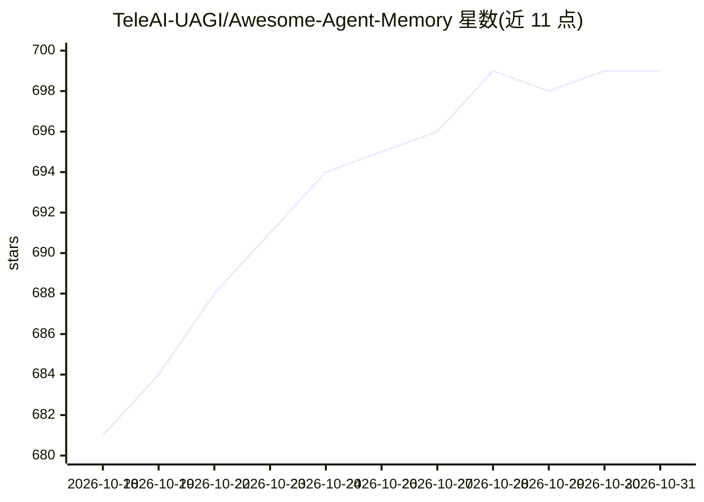

# TeleAI-UAGI/Awesome-Agent-Memory

⭐ 699 · Python · Apache-2.0 · 推送 2026-10-30 · [GitHub](https://github.com/TeleAI-UAGI/Awesome-Agent-Memory) · 组织维护 · 中文 README

**AI agent 记忆系统、基准与论文的策展清单**

由 TeleAI Ubiquitous AGI 团队与 Bloo-Mind AI 维护的 agent 记忆领域 awesome 清单：收录开源产品、教程、综述、基准（纯文本/多模态/动态模拟）、按非参数与参数记忆分类的论文、记忆安全、认知神经科学论文及新闻与工作坊。开源条目以 GitHub star 数排序，少于 100 star 的项目归入折叠的 Emerging 区；带可复现代码的资源加粗；维护方关联条目以 † 标注，drop-in 替代品嵌套于原产品之下。

## 筛选速览

| 维度 | 判定 | 备注 |
|---|---|---|
| AI 角色 | `ai-knowledge` | 知识聚合/清单类 |
| 许可风险 | `permissive` | Apache-2.0 |
| 部署形态 | `None` |  |
| 模型依赖 | — | README 未给出锁定关系 |
| 硬件要求 | — | 无带数字的原话,不猜 |
| 安装摩擦 | `low` | 无编译、无系统依赖或容器化 |
| 成熟度 | — | 结构信号不足 |

## 能力要点

- 按产品/基准/论文（非参数与参数记忆）/安全等类别组织条目
- 开源条目按 GitHub star 排序，star<100 归入 Emerging 折叠区
- 维护方关联条目以 † 标注并遵循同一排序与格式规则
- 归档/有争议项目移入 Archival 区并附证据链接

## 适用场景

- 为自建 agent 挑选合适的记忆层产品
- 选择基准评测记忆系统
- 跟踪 agent 记忆方向的论文与研究进展

## 场景标签

`Agent 记忆` `模型评测` `精选清单` · 领域:Agent 开发

## 证据(README 行号)

> L3:  A curated map of memory for AI agents — the systems, benchmarks, and research that give LLM and multimodal agents l
> L28:  - This list is maintained by Bloo-Mind AI and the Ubiquitous AGI team at TeleAI. Entries affiliated with the maint

## 星数曲线

2026-10-18 681 → 2026-10-31 699（+18）

---
*卡片 v1 · prompt 1.4 · 生成 2026-10-21 · 置信度 high · 依据 README sha `5c2514ba2e6e` · [字段定义](../../DATASET.md)*
