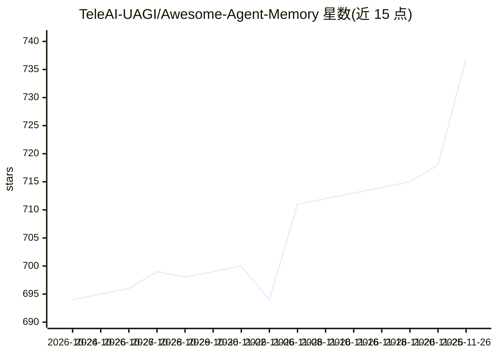

# TeleAI-UAGI/Awesome-Agent-Memory

⭐ 737 · Python · Apache-2.0 · 推送 2026-11-25 · [GitHub](https://github.com/TeleAI-UAGI/Awesome-Agent-Memory) · 组织维护 · 中文 README

**LLM/多模态 agent 记忆系统的资源策展清单**

面向构建或研究 agent 记忆的开发者与科研人员，收录记忆相关产品、教程、综述、基准测试与论文，按非参数/参数记忆、记忆演化、记忆安全等类别组织。收录机制：开源产品按 GitHub star 数排序（CI 校验），低于 100 星进入折叠的 Emerging projects 区；失效或存争议项目移入 Archival 子区并附中性状态标签。API 兼容的替代品作为被替代产品的无排名子条目收录。维护方为 Bloo-Mind AI 与 TeleAI 的 Ubiquitous AGI 团队。

## 筛选速览

| 维度 | 判定 | 备注 |
|---|---|---|
| AI 角色 | `ai-knowledge` | 知识聚合/清单类 |
| 许可风险 | `permissive` | Apache-2.0 |
| 部署形态 | `self-host` | docker 或自建部署 |
| 模型依赖 | — | README 未给出锁定关系 |
| 硬件要求 | — | 无带数字的原话,不猜 |
| 安装摩擦 | `low` | 无编译、无系统依赖或容器化 |
| 成熟度 | — | 结构信号不足 |

## 能力要点

- 覆盖产品、基准、教程、综述、论文等多类资源并分类组织
- 开源产品按 GitHub star 数 CI 校验排序，非质量排名
- 失效/存争议项目移入 Archival 子区并标注状态与核查日期
- API 兼容替代品作为子条目收录并标注维护方关联条目（†）

## 适用场景

- 给正在开发的 agent 挑选一个记忆层产品
- 为记忆系统评估挑选合适的 benchmark
- 跟进记忆架构方向的最新论文与行业动态

## 场景标签

`Agent 记忆` `精选清单` · 领域:Agent 开发

## 证据(README 行号)

> L1: 🧠 Awesome Agent Memory
> L3:  A curated map of memory for AI agents — the systems, benchmarks, and research that give LLM and multimodal agents l
> L23:  📋 How this list is curated

## 星数曲线

2026-10-24 694 → 2026-11-26 737（+43）

---
*卡片 v1 · prompt 1.4 · 生成 2026-11-25 · 置信度 mid · 依据 README sha `1f0f8e39a8eb` · [字段定义](../../DATASET.md)*
