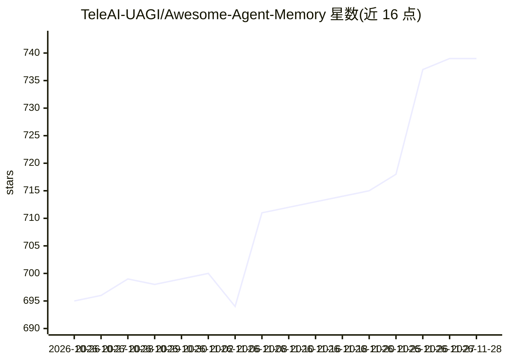

# TeleAI-UAGI/Awesome-Agent-Memory

⭐ 739 · Python · Apache-2.0 · 推送 2026-11-25 · [GitHub](https://github.com/TeleAI-UAGI/Awesome-Agent-Memory) · 组织维护

**LLM/多模态 agent 记忆系统的论文、基准与产品清单**

面向构建或研究 agent 记忆的开发者与研究者，按 Products、Benchmarks、非参数/参数记忆论文、记忆演化、记忆安全等类别组织资源。开源条目按 GitHub star 数排序并以 CI 校验，低于 100 stars 的项目归入 Emerging projects 分区；API 兼容的替代品作为子条目嵌于原产品之下；不活跃或存争议的项目移入 Archival 分区并附状态标签与证据链接。维护方为 TeleAI 的 Ubiquitous AGI 团队与 Bloo-Mind AI。

## 筛选速览

| 维度 | 判定 | 备注 |
|---|---|---|
| AI 角色 | `ai-knowledge` | 知识聚合/清单类 |
| 许可风险 | `permissive` | Apache-2.0 |
| 部署形态 | `self-host` | docker 或自建部署 |
| 模型依赖 | — | README 未给出锁定关系 |
| 硬件要求 | — | 无带数字的原话,不猜 |
| 安装摩擦 | `low` | 无编译、无系统依赖或容器化 |
| 成熟度 | — | 结构信号不足 |

## 能力要点

- 覆盖开源记忆产品、基准、教程、综述与多篇论文的分层目录
- 开源产品按 GitHub star 数排序，经 CI 校验，非质量排序
- 收录记忆安全与防御、持续学习、认知/神经科学中的记忆等专题
- 不活跃/存争议条目移入 Archival 分区并附证据链接与检查日期

## 适用场景

- 为正在开发的 agent 选择一层记忆组件
- 为记忆系统挑选评测基准
- 了解 agent 记忆领域的研究脉络与架构分类
- 跟进记忆持久化、图记忆、多模态记忆等方向的最新论文

## 场景标签

`Agent 记忆` `精选清单` · 领域:Agent 开发

## 证据(README 行号)

> L1: 🧠 Awesome Agent Memory
> L3:  A curated map of memory for AI agents — the systems, benchmarks, and research that give LLM and multimodal agents l
> L25:  - Open-source products are ordered by GitHub star count — an objective, CI-checked popularity signal, not a qualit

## 星数曲线

2026-10-26 695 → 2026-11-28 739（+44）

---
*卡片 v1 · prompt 1.4 · 生成 2026-11-26 · 置信度 mid · 依据 README sha `507f822a4bcc` · [字段定义](../../DATASET.md)*
