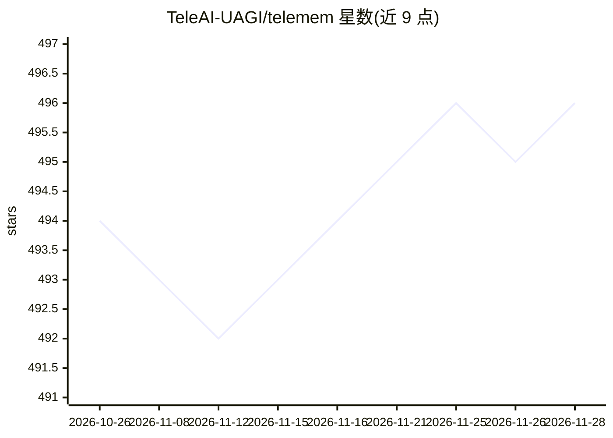

# TeleAI-UAGI/telemem

⭐ 496 · Python · Apache-2.0 · 推送 2026-11-23 · [GitHub](https://github.com/TeleAI-UAGI/telemem) · [官网](https://teleai-uagi.github.io/telemem/) · 组织维护 · 中文 README

**给对话型 AI Agent 提供长期角色记忆与视频多模态记忆层**

TeleMem 是一个 Agent 记忆管理层，可作为 Mem0 的 API 兼容替换（`import telemem as mem0`），处理多轮对话、角色建模、长期信息存储与语义检索。核心机制包括：角色感知摘要、LLM 语义聚类去重、FAISS+JSON 双存储、缓冲批量异步写入；并提供视频→帧提取→字幕→向量库的完整多模态管线与 ReAct 式视频问答。默认本地运行（Qwen+FAISS），支持 MCP 服务器、uvx 零安装运行，提供 pip/uv/conda 三种安装路径。

## 筛选速览

| 维度 | 判定 | 备注 |
|---|---|---|
| AI 角色 | `ai-ecosystem` | LLM/agent 周边工具 |
| 许可风险 | `permissive` | Apache-2.0 |
| 部署形态 | `library` | 以包/库形式分发 |
| 模型依赖 | local-ok | 支持本地模型 |
| 硬件要求 | — | 无带数字的原话,不猜 |
| 安装摩擦 | `low` | 无编译、无系统依赖或容器化 |
| 成熟度 | — | 结构信号不足 |

## 能力要点

- mem0 兼容 API，一行代码替换
- 按角色自动构建隔离的记忆档案
- 视频→帧→字幕→向量库的多模态记忆管线
- MCP 服务器支持 8 个记忆工具，可 uvx 零安装运行

## 适用场景

- 为角色扮演/陪伴类 AI 构建按角色隔离的长期记忆
- 客服或创作助手在长对话中保持角色设定一致
- 让 Agent 存储并检索视频内容进行问答
- 替换现有 Mem0 代码以降低 token 开销

## 场景标签

`Agent 记忆` `RAG` `多模态` · 领域:Agent 开发

## 证据(README 行号)

> L36: TeleMem is an agent memory management layer that can be used as <mark>**a high-performance drop-in replacement for 
> L50: - 🏠 **Fully local by default** — runs end-to-end on your hardware (Qwen + FAISS); no cloud service, no paid tier, n
> L164: pip install "telemem[mcp]"     # + MCP server

## 星数曲线

2026-10-26 494 → 2026-11-28 496（+2）

---
*卡片 v1 · prompt 1.4 · 生成 2026-11-25 · 置信度 high · 依据 README sha `af903d3a435a` · [字段定义](../../DATASET.md)*
