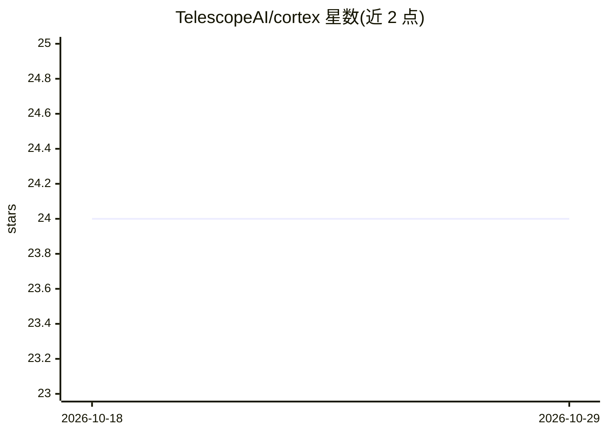

# TelescopeAI/cortex

⭐ 24 · Vue · MIT · 推送 2026-04-11 · [GitHub](https://github.com/TelescopeAI/cortex) · [官网](https://docs.jointelescope.com) · 组织维护

**面向数据应用的轻量语义层：JSON 定义指标并经 REST API 查询**

Cortex 是一个语义层引擎：以 JSON 定义指标、维度与度量，通过查询引擎生成优化的 SQL（带 Redis/内存缓存），支持 PostgreSQL、MySQL、BigQuery、SQLite 及 CSV/Google Sheets 数据源。提供 REST API（OpenAPI 文档）、Python SDK、内置 GUI（Studio）管理数据源与 10+ 种图表的仪表盘，并支持多租户层级（Workspace→Environment→Consumer）与 CSV 上传自动转 SQLite。安装为 pip 安装后 python -m cortex 启动服务。

## 筛选速览

| 维度 | 判定 | 备注 |
|---|---|---|
| AI 角色 | `ai-enhanced` | 去掉 AI 部分产品仍成立 |
| 许可风险 | `permissive` | MIT |
| 部署形态 | `library` | 以包/库形式分发 |
| 模型依赖 | — | README 未给出锁定关系 |
| 硬件要求 | — | 无带数字的原话,不猜 |
| 安装摩擦 | `low` | 无编译、无系统依赖或容器化 |
| 成熟度 | — | 结构信号不足 |

## 能力要点

- JSON 定义指标/维度/度量，生成优化 SQL 查询
- 支持 PostgreSQL、MySQL、BigQuery、SQLite、CSV/Google Sheets 数据源
- REST API（OpenAPI 文档）与 Python SDK
- 多租户层级与内置 GUI（Studio）仪表盘

## 适用场景

- 在应用中统一定义业务指标并通过 API 获取分析数据
- 连接多种数据库搭建指标查询与仪表盘
- 上传 CSV 文件快速转为可查询数据源

## 场景标签

`数据分析` · 领域:效率与自动化

## 证据(README 行号)

> L9: **The simplest semantic layer for building data driven applications.**
> L11: Cortex provides a unified semantic layer that lets you define what matters once and ship analytics faster. Abstract

## 星数曲线

2026-10-18 24 → 2026-10-29 24（+0）

---
*卡片 v1 · prompt 1.4 · 生成 2026-10-27 · 置信度 mid · 依据 README sha `256f76c154ec` · [字段定义](../../DATASET.md)*
