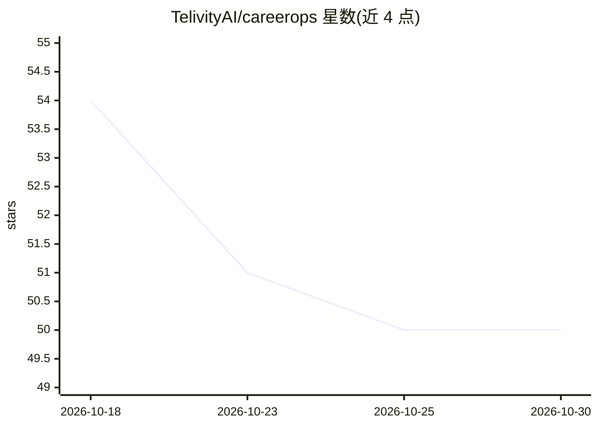

# TelivityAI/careerops

⭐ 50 · JavaScript · Apache-2.0 · 推送 2026-09-22 · [GitHub](https://github.com/TelivityAI/careerops) · 组织维护

**本地优先的求职与职业记录应用：成果记忆、简历、面试、offer 一体**

面向工程师、PM、设计师等求职者的本地优先职业管理应用：以不可变的成果记录（memory）为核心，支持看板式职位追踪（可从公开 ATS 拉取）、基于用户自写证据生成并版本化简历草稿（AI 仅改写不虚构）、面试准备、offer 条款对比与作品集整理。数据本地存储，Apache 2.0 开源，通过 npx 命令 5 分钟初始化，后端使用 Supabase（schema/RLS/Edge functions），不提供自动投递功能。

## 筛选速览

| 维度 | 判定 | 备注 |
|---|---|---|
| AI 角色 | `ai-enhanced` | 去掉 AI 部分产品仍成立 |
| 许可风险 | `permissive` | Apache-2.0 |
| 部署形态 | `library` | 以包/库形式分发 |
| 模型依赖 | — | README 未给出锁定关系 |
| 硬件要求 | — | 无带数字的原话,不猜 |
| 安装摩擦 | `low` | 无编译、无系统依赖或容器化 |
| 成熟度 | — | 结构信号不足 |

## 能力要点

- 成果记录不可变、按需晋升（promote）为简历素材的证据驱动流程
- AI 只改写用户自写内容、不虚构指标（L79 声明）
- 看板式职位追踪 + 简历版本化 + 面试准备 + offer 对比一站式
- 本地优先设计，Supabase schema 带 RLS，提供插件系统与 Agent Skill

## 适用场景

- 我想把每次工作成果记下来，下次改简历不用从零开始
- 用一个工具替代求职追踪表、简历生成器和面试笔记
- 对比多个 offer 的条款再做决定

## 场景标签

`知识库管理` `AI 写作` · 领域:内容生成

## 证据(README 行号)

> L15: One local-first app that replaces your resume builder, job tracker, interview notes, accomplishment journal, and of
> L33: Generate drafts from ranked, user-authored memory—not invented metrics. Edit, version, export, then you apply on th
> L79: |Evidence|User-authored only; AI rewrites, never invents|AI-generated claims common|

## 星数曲线

2026-10-18 54 → 2026-10-30 50（-4）

---
*卡片 v1 · prompt 1.4 · 生成 2026-10-24 · 置信度 high · 依据 README sha `405ea2191aca` · [字段定义](../../DATASET.md)*
