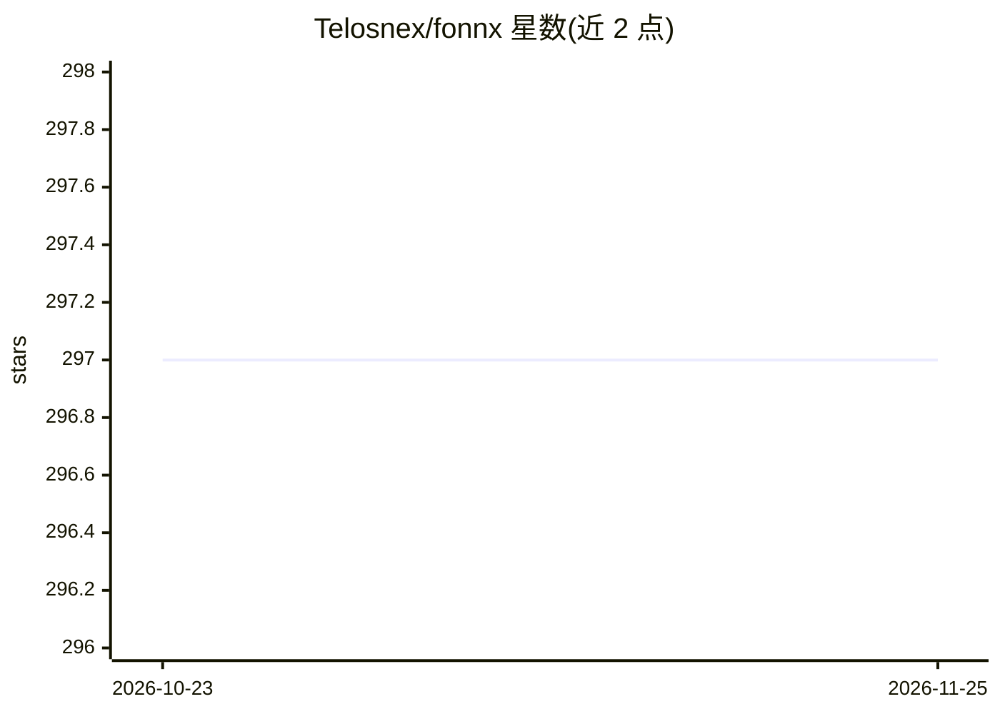

# Telosnex/fonnx

⭐ 297 · Dart · NOASSERTION · 推送 2026-11-20 · [GitHub](https://github.com/Telosnex/fonnx) · [官网](https://telosnex.github.io/fonnx/) · 组织维护

**在 Flutter 全平台本地运行 ONNX 模型的库**

面向 Flutter 开发者的 ONNX 推理库，通过 Dart FFI 与 Native Assets 在 iOS、Android、Linux、macOS、Windows 及 Web（WASM SIMD）上运行 ONNX 模型，无需 Kotlin/Swift 平台通道或 CocoaPods/Gradle 依赖。内置多种模型能力：Whisper 语音转写、Silero VAD 语音活动检测、开放词汇关键词唤醒、MiniLM 文本嵌入、提示注入检测、FUTO 滑行输入解码。发布包附带 SHA-256 校验的预编译原生资产，源码构建需 CMake 与目标平台编译器。

## 筛选速览

| 维度 | 判定 | 备注 |
|---|---|---|
| AI 角色 | `ai-ecosystem` | LLM/agent 周边工具 |
| 许可风险 | `none` | NOASSERTION |
| 部署形态 | `None` |  |
| 模型依赖 | — | README 未给出锁定关系 |
| 硬件要求 | — | 无带数字的原话,不猜 |
| 安装摩擦 | `low` | 无编译、无系统依赖或容器化 |
| 成熟度 | — | 结构信号不足 |

## 能力要点

- 单套 Dart FFI 实现覆盖六大平台，Web 走 ONNX Runtime worker
- 内置 Whisper 转写、Silero VAD、关键词唤醒、文本嵌入、提示注入检测等模型封装
- 发布包经 SHA-256 校验下载预编译原生代码资产，无需 C 编译器
- iOS 走 CoreML、Android 走 Neural Networks API、Web 走 WASM SIMD 的平台加速

## 适用场景

- 在 Flutter 应用中离线运行语音识别与语音活动检测
- 端侧生成文本嵌入支撑本地语义搜索与 RAG
- 在移动端检测邮件或网页文本的提示注入风险
- 在 Flutter 键盘应用中实现离线滑行输入与下一词预测

## 场景标签

`语音识别` `语义搜索` `推理引擎` · 领域:知识与检索

## 证据(README 行号)

> L72: FONNX is a Flutter library for running ONNX models.
> L74: FONNX leverages ONNX to provide native acceleration capabilities, from CoreML on iOS, to Android Neural Networks AP
> L226: ## Native platforms via Dart FFI and code assets

## 星数曲线

2026-10-23 297 → 2026-11-25 297（+0）

---
*卡片 v1 · prompt 1.4 · 生成 2026-11-25 · 置信度 high · 依据 README sha `b963914e9817` · [字段定义](../../DATASET.md)*
