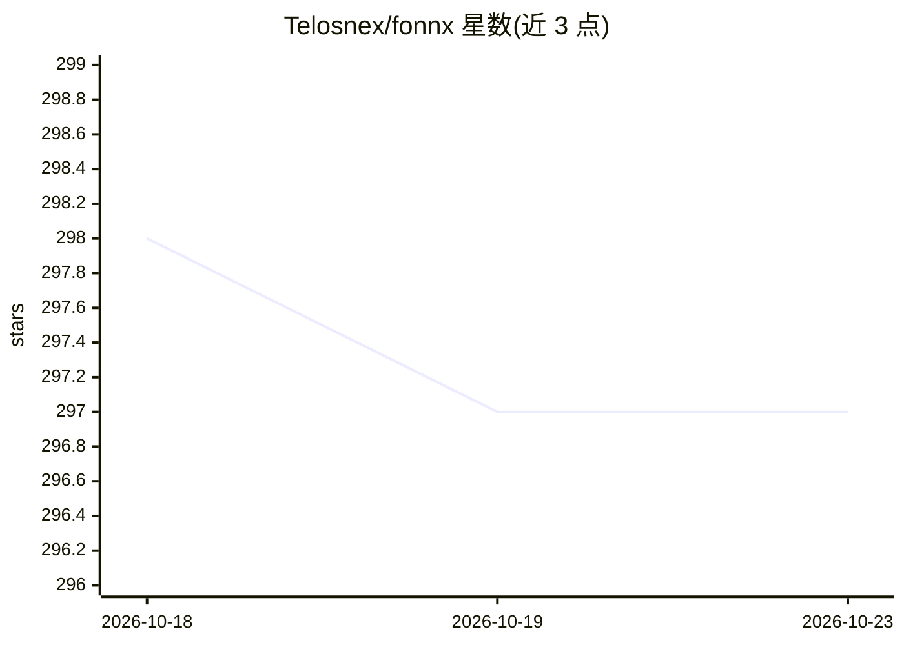

# Telosnex/fonnx

⭐ 297 · Dart · NOASSERTION · 推送 2026-10-22 · [GitHub](https://github.com/Telosnex/fonnx) · [官网](https://telosnex.github.io/fonnx/) · 组织维护

**Flutter 库：在六大平台本地运行 ONNX 模型**

面向 Flutter 开发者的 ONNX 推理库，在 iOS、Android、Web、Linux、Windows、macOS 上本地运行 ONNX 模型，提供 CoreML、Android Neural Networks API、WASM SIMD 等平台加速。通过单一 Dart FFI 实现与 Native Assets 分发预编译 ORT 二进制，发布包无需 C 编译器，且无 CocoaPods/Gradle 原生依赖。附带文本嵌入（MiniLM）、Whisper、Silero VAD、关键词 spotting、FUTO 滑行解码等模型支持与示例应用。限制：iOS 需 15.1+，macOS 需 Apple Silicon 14+。

## 筛选速览

| 维度 | 判定 | 备注 |
|---|---|---|
| AI 角色 | `ai-ecosystem` | LLM/agent 周边工具 |
| 许可风险 | `none` | NOASSERTION |
| 部署形态 | `None` |  |
| 模型依赖 | — | README 未给出锁定关系 |
| 硬件要求 | — | 无带数字的原话,不猜 |
| 安装摩擦 | `low` | 无编译、无系统依赖或容器化 |
| 成熟度 | — | 结构信号不足 |

## 能力要点

- 六个平台共用同一 Dart FFI 推理实现，无平台通道
- 发布包下载并校验预编译 ORT 代码资产，无需 C 编译器
- 内置文本嵌入、Whisper、Silero VAD、开放词表关键词 spotting、FUTO 滑行解码等模型
- Linux aarch64 支持 Raspberry Pi/flutter-pi

## 适用场景

- 在 Flutter 应用内离线运行文本嵌入与语义搜索
- 构建端侧语音助手（Whisper + VAD + 关键词唤醒）
- 将 PyTorch/TensorFlow 模型转 ONNX 后集成到跨平台应用

## 场景标签

`推理引擎` · 领域:训练与推理

## 证据(README 行号)

> L80: FONNX is a Flutter library for running ONNX models.
> L82: FONNX leverages ONNX to provide native acceleration capabilities, from CoreML on iOS, to Android Neural Networks AP

## 星数曲线

2026-10-18 298 → 2026-10-23 297（-1）

---
*卡片 v1 · prompt 1.4 · 生成 2026-10-21 · 置信度 high · 依据 README sha `615c7e7efd6c` · [字段定义](../../DATASET.md)*
