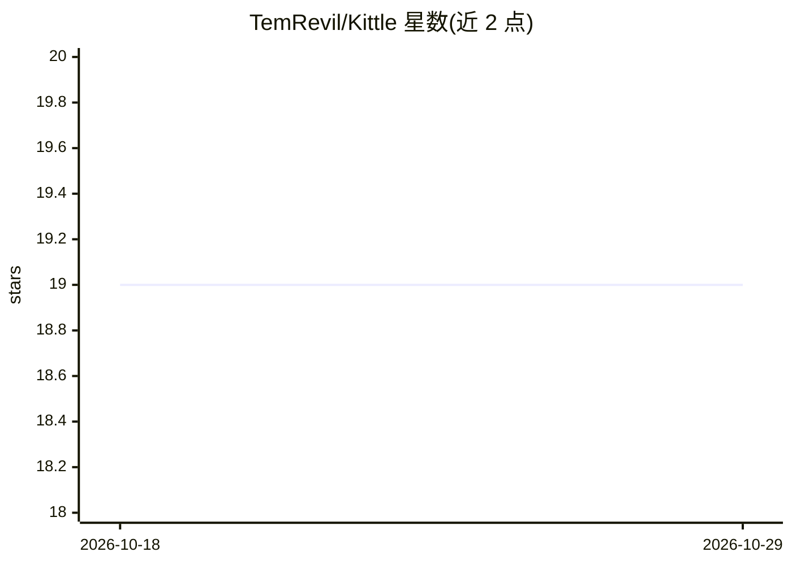

# TemRevil/Kittle

⭐ 19 · TypeScript · 推送 2026-06-10 · [GitHub](https://github.com/TemRevil/Kittle) · [官网](https://temrevil.github.io/Kittle/) · 个人维护

**浏览器端 AI 代码分析助手：直连多家 LLM 审查代码**

基于 Next.js/TypeScript/Tailwind 的纯静态前端应用：在浏览器中读取本地文件与 GitHub 仓库结构，通过直连 API 调用 Gemini、GPT-4o、Claude 3.5、DeepSeek R1 等模型进行代码分析与调试辅助，并支持通过对话生成 Mermaid.js 架构图。采用零服务器架构，API key 仅存于浏览器端。需 Node.js v20+ 与 npm，通过 git clone 源码安装运行，GitHub Actions 自动部署。

## 筛选速览

| 维度 | 判定 | 备注 |
|---|---|---|
| AI 角色 | `ai-native` | 本体是模型或模型工具 |
| 许可风险 | `none` | — |
| 部署形态 | `library` | 以包/库形式分发 |
| 模型依赖 | locked-api |  |
| 硬件要求 | — | 无带数字的原话,不猜 |
| 安装摩擦 | `low` | 无编译、无系统依赖或容器化 |
| 成熟度 | — | 结构信号不足 |

## 能力要点

- 直连 Gemini/GPT-4o/Claude 3.5/DeepSeek R1 多模型 API
- 通过对话生成 Mermaid.js 架构图（Design Mode）
- 集成本地文件与 GitHub 仓库的上下文分析
- 零服务器架构，API key 不离开浏览器

## 适用场景

- 在浏览器中分析仓库结构与调试代码逻辑
- 与代码对话生成实时架构图
- 不希望 API key 经过服务端的本地化 AI 代码审查

## 场景标签

`代码审查` · 领域:编码与开发

## 证据(README 行号)

> L12: **Kittle** is an advanced AI coding assistant that lives where your code does. It provides a seamless interface to 
> L20: |**🧠 Multi-Model Intelligence**|Connect to **Gemini 2.0/Thinking**, **GPT-4o**, **Claude 3.5**, and **DeepSeek R1**

## 星数曲线

2026-10-18 19 → 2026-10-29 19（+0）

---
*卡片 v1 · prompt 1.4 · 生成 2026-10-28 · 置信度 high · 依据 README sha `61631bd3b7d3` · [字段定义](../../DATASET.md)*
