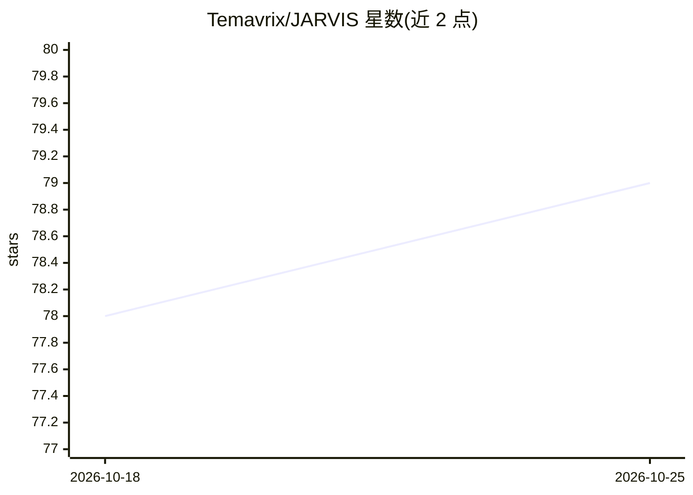

# Temavrix/JARVIS

⭐ 79 · Python · AGPL-3.0 · 推送 2026-01-02 · [GitHub](https://github.com/Temavrix/JARVIS) · [官网](https://temavrix.github.io/epicalable.html) · 组织维护

**带 GUI 的桌面聊天机器人，提供天气、新闻、股票、Wiki 等回答**

基于自然语言处理与机器学习的桌面聊天机器人，通过图形界面提供天气、新闻标题、股票价格、Wikipedia 搜索与对话式问答。运行方式为打开 Jarvis.py 文件；预训练数据保存在 jardata.pth，用户 API 密钥存储在 jarsettings.json；对话回复从训练数据集 Jarintents 中检索。README 未提供安装命令与依赖清单，仅说明运行入口与数据文件结构。

## 筛选速览

| 维度 | 判定 | 备注 |
|---|---|---|
| AI 角色 | `ai-native` | 本体是模型或模型工具 |
| 许可风险 | `viral` | AGPL-3.0 |
| 部署形态 | `None` |  |
| 模型依赖 | — | README 未给出锁定关系 |
| 硬件要求 | — | 无带数字的原话,不猜 |
| 安装摩擦 | `low` | 无编译、无系统依赖或容器化 |
| 成熟度 | — | 结构信号不足 |

## 能力要点

- 图形界面对话交互
- 结合天气、新闻、股票、Wikipedia 等实时网络服务
- 预训练模型数据存于 jardata.pth，回复从 Jarintents 数据集检索

## 适用场景

- 通过桌面 GUI 进行对话问答
- 查询天气、新闻标题、股票价格与 Wikipedia 内容

## 场景标签

`聊天机器人` · 领域:对话与助手

## 证据(README 行号)

> L2: ###### A Neural Chatbot with a GUI made for you to get News Headlines, Weather, Stocks, Wiki and more....
> L29: To run JARVIS, user are to open up the Jarvis.py file

## 星数曲线

2026-10-18 78 → 2026-10-25 79（+1）

---
*卡片 v1 · prompt 1.4 · 生成 2026-10-24 · 置信度 mid · 依据 README sha `607cc4b0b4c0` · [字段定义](../../DATASET.md)*
