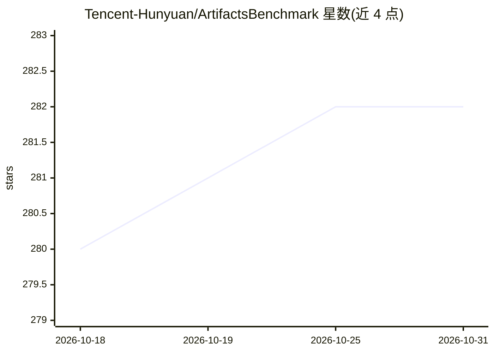

# Tencent-Hunyuan/ArtifactsBenchmark

⭐ 282 · Python · NOASSERTION · 推送 2025-12-30 · [GitHub](https://github.com/Tencent-Hunyuan/ArtifactsBenchmark) · [官网](https://artifactsbenchmark.github.io/) · 组织维护 · 中文 README

**面向交互式可视代码生成的自动化多模态评测基准（1,825 任务）**

腾讯混元团队开源的 LLM 代码生成评测基准：包含 1,825 个源自真实应用的任务，覆盖组件化 Web 开发、SVG 数据可视化与交互小游戏，按简单/中等/困难分层。评测管线程序化渲染生成产物，以三步截图捕捉动态行为，再由 MLLM-as-Judge（Gemini-2.5-Pro 或 Qwen2.5-VL-72B）按逐任务细粒度清单打分；团队报告与 WebDev Arena 人类投票排序一致性达 94.4%。提供评测数据、全量中间结果与复现脚本，已评测 30 余个 LLM。环境依赖 vllm、playwright 等，需 API key 或本地部署 judge 模型。

## 筛选速览

| 维度 | 判定 | 备注 |
|---|---|---|
| AI 角色 | `ai-ecosystem` | LLM/agent 周边工具 |
| 许可风险 | `none` | NOASSERTION |
| 部署形态 | `library` | 以包/库形式分发 |
| 模型依赖 | local-ok | 支持本地模型 |
| 硬件要求 | — | 无带数字的原话,不猜 |
| 安装摩擦 | `low` | 无编译、无系统依赖或容器化 |
| 成熟度 | — | 结构信号不足 |

## 能力要点

- 1,825 个任务、9 个类别、三档难度分层
- 渲染+三步时间序列截图的自动化证据采集
- MLLM-as-Judge 按逐任务细粒度清单评分，支持 Gemini 与 Qwen2.5-VL-72B（vllm 部署）
- 评测数据与中间结果（judge 推理链）全部开源，支持论文级复现

## 适用场景

- 评测我的模型在交互式可视产物（网页/小游戏/可视化）生成上的表现
- 复现论文结果或对比 30+ 已评模型的分数
- 用自动化评测替代成本高的人工偏好投票

## 场景标签

`模型评测` · 领域:评测与运维

## 证据(README 行号)

> L17: To bridge this gap, we introduce **ArtifactsBench**, a new benchmark and paradigm for the automated, multimodal eva
> L19: ArtifactsBench is open-sourced, including the benchmark with **1,825 diverse tasks**, the evaluation harness, and b
> L92: - **A Novel Multimodal and Automated Evaluation Pipeline:** We propose a new evaluation strategy that synergizes au

## 星数曲线

2026-10-18 280 → 2026-10-31 282（+2）

---
*卡片 v1 · prompt 1.4 · 生成 2026-10-22 · 置信度 mid · 依据 README sha `b9e54e739d5c` · [字段定义](../../DATASET.md)*
