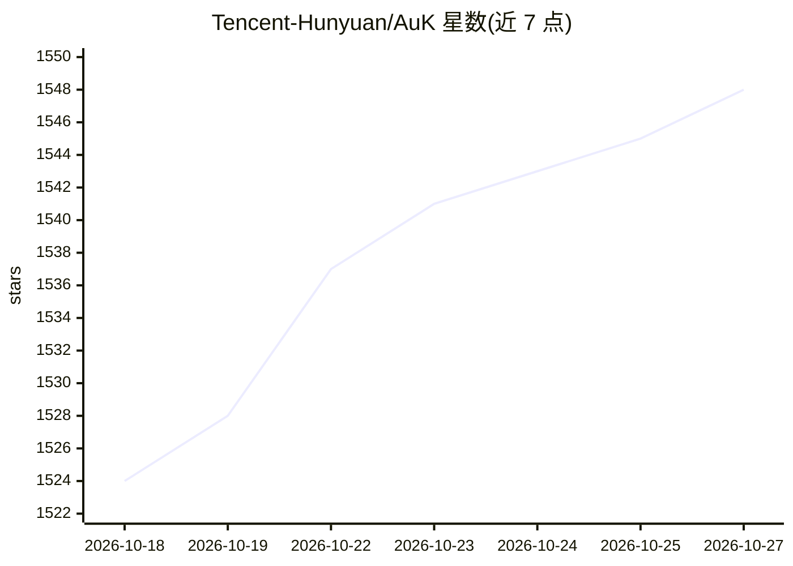

# Tencent-Hunyuan/AuK

⭐ 1,548 · Python · NOASSERTION · 推送 2026-10-22 · [GitHub](https://github.com/Tencent-Hunyuan/AuK) · [官网](https://auk-project.github.io/) · 组织维护 · 中文 README

**1.5B 语音生成与编辑基础模型，支持 TTS/编辑/分离等任务**

腾讯混元开源的 1.5B 语音基础模型及配套代码，基于数百万小时音频训练，通过统一的自然语言指令接口完成零样本 TTS、指令 TTS、内容/声学/副语言编辑、语音增强与分离等任务。提供 Base 与蒸馏版 AuK-Flash（4 步快速推理）两个变体，权重发布于 Hugging Face 与 ModelScope。以 git clone 源码 + uv/Conda（Python 3.10）方式安装，提供 auk-infer CLI、auk-gradio 网页演示、Python API 与 ComfyUI 集成；编码器使用 Qwen2.5-Omni-3B。支持 CUDA CPU offload、MLX Apple Silicon 推理分支，并有音频预处理工具 Prompt Enhancer（需 OpenAI 兼容 LLM）。

## 筛选速览

| 维度 | 判定 | 备注 |
|---|---|---|
| AI 角色 | `ai-native` | 本体是模型或模型工具 |
| 许可风险 | `none` | NOASSERTION |
| 部署形态 | `library` | 以包/库形式分发 |
| 模型依赖 | — | README 未给出锁定关系 |
| 硬件要求 | — | 无带数字的原话,不猜 |
| 安装摩擦 | `medium` | 含编译或系统依赖之一 |
| 成熟度 | — | 结构信号不足 |

## 能力要点

- 统一自然语言指令接口覆盖 TTS/编辑/增强/分离等任务
- AuK-Flash 蒸馏变体支持 4 步快速推理
- CLI、Gradio 网页演示、Python API 与 ComfyUI 集成多种使用方式
- 支持 CUDA CPU offload、MLX Apple Silicon 推理分支与 audio.cpp GGUF 推理

## 适用场景

- 用参考音频做零样本语音合成或按音色描述生成语音
- 对录音做文本替换、语速/音高/情感等编辑
- 从混音中提取人声或做降噪、去混响处理
- 通过 Gradio 网页或 ComfyUI 工作流交互使用模型

## 场景标签

`语音合成` · 领域:内容生成

## 证据(README 行号)

> L30: **AuK** is a 1.5B foundation model for speech generation and editing. Trained on millions of hours of diverse audio
> L32: speech enhancement, and source separation through a unified natural-language
> L50: AuK exposes every task through the same natural-language instruction interface. The table below groups the supporte

## 星数曲线

2026-10-18 1,524 → 2026-10-27 1,548（+24）

---
*卡片 v1 · prompt 1.4 · 生成 2026-10-21 · 置信度 high · 依据 README sha `f7a3d19ab28f` · [字段定义](../../DATASET.md)*
