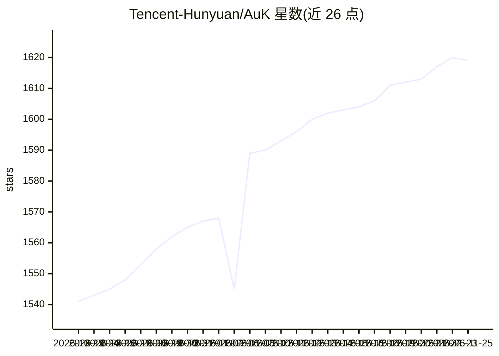

# Tencent-Hunyuan/AuK

⭐ 1,619 · Python · NOASSERTION · 推送 2026-11-19 · [GitHub](https://github.com/Tencent-Hunyuan/AuK) · [官网](https://auk-project.github.io/) · 组织维护 · 中文 README

**15亿参数语音生成与编辑基础模型，统一自然语言指令接口**

腾讯混元开源的 1.5B 语音基础模型，在数百万小时音频上训练，通过统一自然语言指令接口提供零样本 TTS、Instruct TTS、内容/声学/副语言编辑、语音增强与分离（含音乐分离、目标说话人提取）。提供基础版 AuK 与 4 步蒸馏版 AuK-Flash 两个变体，权重发布于 Hugging Face 与 ModelScope。支持 CLI（auk-infer）、Gradio 网页演示与 ComfyUI 节点运行，Prompt Enhancer 需 OpenAI 兼容 LLM 环境变量。

## 筛选速览

| 维度 | 判定 | 备注 |
|---|---|---|
| AI 角色 | `ai-native` | 本体是模型或模型工具 |
| 许可风险 | `none` | NOASSERTION |
| 部署形态 | `library` | 以包/库形式分发 |
| 模型依赖 | local-ok | 支持本地模型 |
| 硬件要求 | — | 无带数字的原话,不猜 |
| 安装摩擦 | `medium` | 含编译或系统依赖之一 |
| 成熟度 | — | 结构信号不足 |

## 能力要点

- 统一指令接口覆盖 17 类任务：TTS、内容/声学/副语言编辑、增强与分离
- 两个变体：AuK 基础版与 4 步推理的蒸馏版 AuK-Flash
- bf16 推理峰值 VRAM 约 25 GiB，--cpu_offload 可降至约 17 GiB
- 被 audio.cpp、vLLM-Omni、SGLang-Omni 与 Apple Silicon MLX 支持接入

## 适用场景

- 零样本克隆参考音色朗读指定文本
- 改写录音中的说话内容或歌词而保留音色旋律
- 对录音去噪、去混响或按说话人分离人声
- 调整语速、音高、音量或情绪等副语言属性

## 场景标签

`语音合成` · 领域:内容生成

## 证据(README 行号)

> L31: **AuK** is a 1.5B foundation model for speech generation and editing. Trained on millions of hours of diverse audio
> L33: speech enhancement, and source separation through a unified natural-language

## 星数曲线

2026-10-23 1,541 → 2026-11-25 1,619（+78）

---
*卡片 v1 · prompt 1.4 · 生成 2026-11-23 · 置信度 high · 依据 README sha `aa5fe819f1d8` · [字段定义](../../DATASET.md)*
