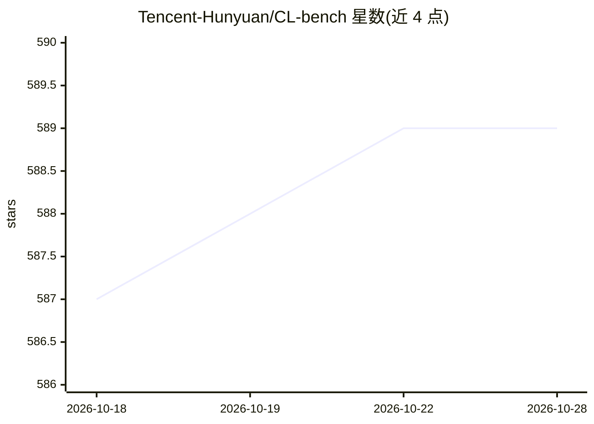

# Tencent-Hunyuan/CL-bench

⭐ 590 · Python · NOASSERTION · 推送 2026-10-17 · [GitHub](https://github.com/Tencent-Hunyuan/CL-bench) · 组织维护 · 中文 README

**腾讯混元团队的语言模型上下文学习能力评测基准集**

包含两个基准：CL-bench 收录 1,899 个专业与领域特定的上下文学习任务（4 类 18 子类，平均每上下文 63.2 条评分细则），CL-bench Life 收录 405 个真实生活场景任务（5,348 条 rubrics），覆盖群聊、个人笔记、游戏日志等碎片化数据。每个实例含系统提示、任务、含新知识的上下文与评分规则，由领域专家标注。评测管线通过 pip 安装依赖、从 HuggingFace 下载 JSONL 数据，用 GPT-5.1 作为裁判模型做二元判定（须通过全部 rubrics 才算解决），通过提交 PR 上榜。

## 筛选速览

| 维度 | 判定 | 备注 |
|---|---|---|
| AI 角色 | `ai-knowledge` | 知识聚合/清单类 |
| 许可风险 | `none` | NOASSERTION |
| 部署形态 | `library` | 以包/库形式分发 |
| 模型依赖 | — | README 未给出锁定关系 |
| 硬件要求 | — | 无带数字的原话,不猜 |
| 安装摩擦 | `low` | 无编译、无系统依赖或容器化 |
| 成熟度 | — | 结构信号不足 |

## 能力要点

- 1,899 个专业领域上下文学习任务 + 405 个真实生活任务
- 平均每上下文 20 小时专家标注、63.2 条评分 rubrics
- 统一评测管线：推理与 GPT-5.1 裁判评分，二元判定须通过全部 rubrics
- 数据以 JSONL 格式托管于 HuggingFace，结果可提交 PR 登上排行榜

## 适用场景

- 评测语言模型从上下文中即时学习新知识的能力
- 在真实生活碎片化数据（群聊/笔记/日志）上测试模型
- 将模型成绩提交至 CL-bench 排行榜

## 场景标签

`模型评测` · 领域:评测与运维

## 证据(README 行号)

> L25: CL-bench evaluates whether language models can learn new knowledge from context at inference time. Tasks require mo
> L35: **Stats**: 1,899 tasks · 4 categories · 18 sub-categories · avg. 63.2 rubrics per context · avg. 20 hours expert ef

## 星数曲线

2026-10-18 587 → 2026-10-28 589（+2）

---
*卡片 v1 · prompt 1.4 · 生成 2026-10-21 · 置信度 mid · 依据 README sha `a225736cf66a` · [字段定义](../../DATASET.md)*
