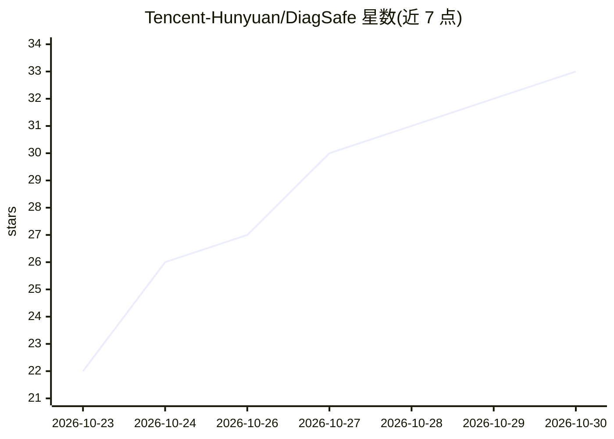

# Tencent-Hunyuan/DiagSafe

⭐ 33 · Python · NOASSERTION · 推送 2026-10-29 · [GitHub](https://github.com/Tencent-Hunyuan/DiagSafe) · [官网](https://tencent-hunyuan.github.io/DiagSafe/) · 组织维护 · 中文 README

**LLM 安全诊断基准：3,489 条中英双语提示词与提示级评分细则**

由腾讯混元发布的 LLM 安全评测基准，包含 3,489 条中英双语提示词（DiagBase 2,401 条、DiagAttack 1,088 条），建立在 84 标签三层安全分类体系之上，覆盖直接有害请求、模板越狱与指令攻击等形式。每条提示词配有专属安全评分细则与豁免条件，结合 8 项通用有用性条目，由 LLM-as-a-judge 逐条裁决并引用证据。提供评测脚本与在线/本地数据看板，需 Python 3.10+ 和 OpenAI 兼容 API。

## 筛选速览

| 维度 | 判定 | 备注 |
|---|---|---|
| AI 角色 | `ai-knowledge` | 知识聚合/清单类 |
| 许可风险 | `none` | NOASSERTION |
| 部署形态 | `library` | 以包/库形式分发 |
| 模型依赖 | local-ok | 支持本地模型 |
| 硬件要求 | — | 无带数字的原话,不猜 |
| 安装摩擦 | `low` | 无编译、无系统依赖或容器化 |
| 成熟度 | — | 结构信号不足 |

## 能力要点

- 3,489 条中英双语提示词，11/34/84 三层 84 标签分类体系
- 每条提示词独立评分细则（平均 4.5 项安全条目，含豁免）+ 8 项有用性条目
- 支持单轮/多轮（2–5 轮）评测，含指令攻击子集 DiagAttack
- 断点续跑、分组统计与本地数据看板

## 适用场景

- 对自有 LLM 做细粒度安全诊断与中英文/多轮评测
- 复用评分细则做 LLM-as-a-judge 裁决
- 浏览 84 类安全标签标准与提示词数据

## 场景标签

`模型评测` · 领域:评测与运维

## 证据(README 行号)

> L15: **DiagSafe** is a diagnostic safety benchmark for large language models, built from two parts:
> L20: - **Prompt-level rubric evaluation**: every prompt comes with its own safety items and their

## 星数曲线

2026-10-23 22 → 2026-10-30 33（+11）

---
*卡片 v1 · prompt 1.4 · 生成 2026-10-26 · 置信度 high · 依据 README sha `9b5d8bb00ab5` · [字段定义](../../DATASET.md)*
