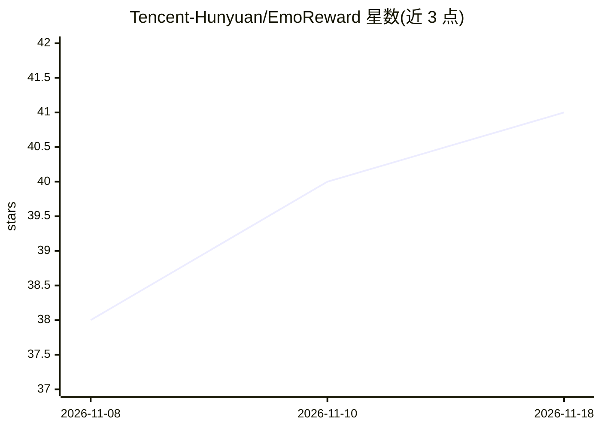

# Tencent-Hunyuan/EmoReward

⭐ 41 · Python · NOASSERTION · 推送 2026-11-05 · [GitHub](https://github.com/Tencent-Hunyuan/EmoReward) · [官网](https://emoreward-project.github.io/) · 组织维护 · 中文 README

**情感视频生成 RL 的自进化奖励校准机制官方实现**

面向情感视频生成强化学习的训练机制官方实现：从实际训练运行的奖励轨迹中提炼证据可靠性，通过 Reflective Reward Gating 在视频内校准异构奖励信号（相位/人脸/冲突/微妙性门控），通过 RewardMemory 在跨运行间固定有界融合权重乘子，全程不更新奖励模型参数。即插即用于 HunyuanVideo-1.5 上的 SAGE-GRPO 训练，与通用视频奖励融合，并可迁移至 DanceGRPO 与 FlowGRPO。需三组权重（基础模型、通用视频奖励、四个情感奖励提供方）；提供方权重缺失时优雅降级并重新分配融合权重。两条训练运行由单命令串联完成，支持单机/多节点。

## 筛选速览

| 维度 | 判定 | 备注 |
|---|---|---|
| AI 角色 | `ai-ecosystem` | LLM/agent 周边工具 |
| 许可风险 | `none` | NOASSERTION |
| 部署形态 | `library` | 以包/库形式分发 |
| 模型依赖 | — | README 未给出锁定关系 |
| 硬件要求 | — | 无带数字的原话,不猜 |
| 安装摩擦 | `low` | 无编译、无系统依赖或容器化 |
| 成熟度 | — | 结构信号不足 |

## 能力要点

- Reflective Reward Gating 按视频实例门控校准异构情感奖励信号
- RewardMemory 从已完成运行的轨迹提炼有界融合权重乘子，冻结用于下一运行
- 不更新任何奖励模型参数，仅改变记忆表与闭式融合权重
- 兼容 SAGE-GRPO/DanceGRPO/FlowGRPO 三种视频 RL 算法

## 适用场景

- 在情感视频生成 RL 训练中降低奖励被刷分的风险
- 跨训练运行复用奖励可靠性经验指导多奖励权重分配
- 做奖励策略消融实验（同一脚本切换 REWARD_GATE_POLICY）

## 场景标签

`视频生成` `强化学习` · 领域:内容生成

## 证据(README 行号)

> L11: EmoReward is a **self-evolving training mechanism** for emotional video-generation RL. It distills *evidence reliab
> L19: - **EmoReward — a self-evolving training mechanism.** We introduce a mechanism for emotional video-generation RL th
> L21: - **RewardMemory — memory for multi-reward video generation.** We propose a memory that distills contextual evidenc

## 星数曲线

2026-11-08 38 → 2026-11-18 41（+3）

---
*卡片 v1 · prompt 1.4 · 生成 2026-11-18 · 置信度 mid · 依据 README sha `b8b1efa9579b` · [字段定义](../../DATASET.md)*
