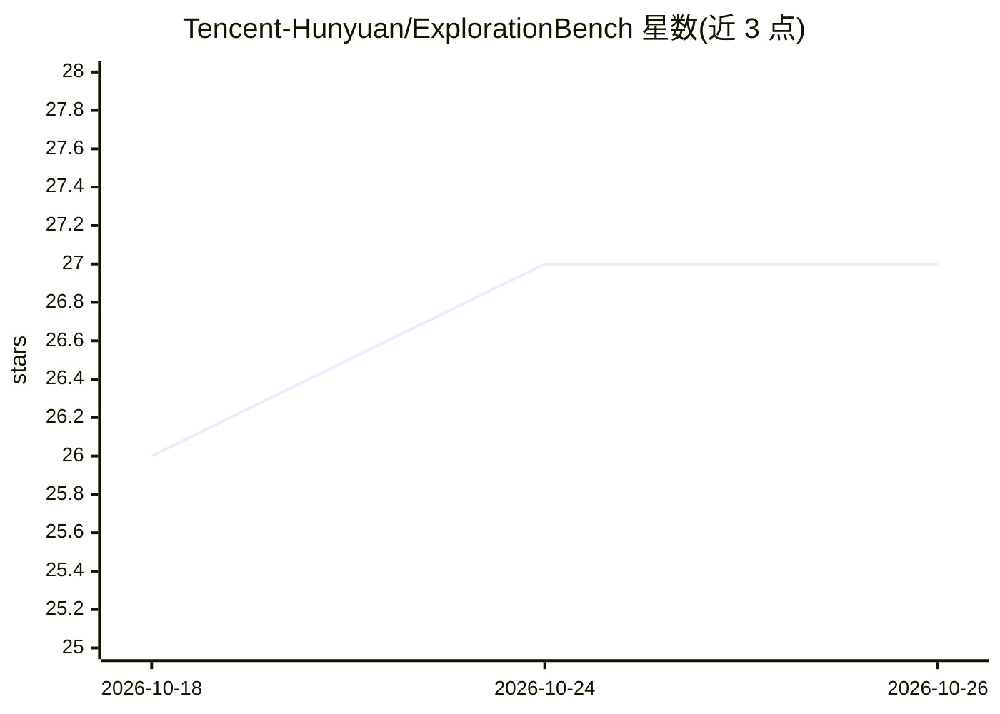

# Tencent-Hunyuan/ExplorationBench

⭐ 27 · Python · NOASSERTION · 推送 2026-10-14 · [GitHub](https://github.com/Tencent-Hunyuan/ExplorationBench) · 组织维护 · 中文 README

**评测 AI 系统在可验证异星世界中探索能力的基准**

腾讯混元联合复旦、清华发布的 AI 探索能力基准：构建两个规则可执行且刻意违背常识的异星世界（AlienCode 程序合成、AlienLogic 一阶自然演绎证明），系统从有缺陷的手册与固定示例出发，经四轮自主实验探查规则，每轮由禁用工具的副本报告所信规则并作答 140 道保留任务，判定由解释器或证明检查器给出，无 LLM 裁判。评测世界规则保密，仓库公开评测代码、两个公开演示世界与分析脚本；私有世界评测需联系团队代跑。

## 筛选速览

| 维度 | 判定 | 备注 |
|---|---|---|
| AI 角色 | `ai-ecosystem` | LLM/agent 周边工具 |
| 许可风险 | `none` | NOASSERTION |
| 部署形态 | `library` | 以包/库形式分发 |
| 模型依赖 | — | README 未给出锁定关系 |
| 硬件要求 | — | 无带数字的原话,不猜 |
| 安装摩擦 | `low` | 无编译、无系统依赖或容器化 |
| 成熟度 | — | 结构信号不足 |

## 能力要点

- 两个规则可执行的异星沙盒，55 个发现目标、140 道保留任务
- 四轮自主探索协议，判定全部来自解释器/证明检查器，无 LLM 裁判
- 公开演示世界与演示检查命令，无需 API key 即可运行
- 私有评测世界通过联系团队以同一协议代为评测

## 适用场景

- 评测前沿模型通过自主探索获取新规则的能力
- 复现论文协议或基于演示世界开发评测扩展
- 查看 10 个前沿系统在探索任务上的排行榜与轨迹

## 场景标签

`模型评测` · 领域:评测与运维

## 证据(README 行号)

> L33: Scientific discovery begins where known problems end. There, AI systems must explore: frame hypotheses, design expe
> L45: **Stats**: 2 sandboxes · 55 discovery targets · 140 held-out tasks · 10 frontier systems · 3 independent trajectori
> L97: - **The evaluation code, as it ran for the paper**: harnesses, protocol, scoring, control conditions, three answers

## 星数曲线

2026-10-18 26 → 2026-10-26 27（+1）

---
*卡片 v1 · prompt 1.4 · 生成 2026-10-26 · 置信度 mid · 依据 README sha `243088889d3f` · [字段定义](../../DATASET.md)*
