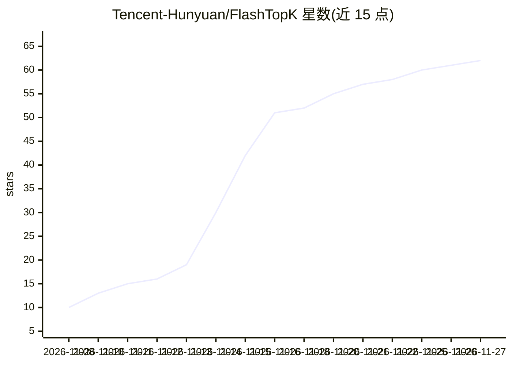

# Tencent-Hunyuan/FlashTopK

⭐ 62 · Python · Apache-2.0 · 推送 2026-11-09 · [GitHub](https://github.com/Tencent-Hunyuan/FlashTopK) · [官网](https://arxiv.org/abs/2610.32057) · 组织维护 · 中文 README

**学习型稀疏注意力训练与推理的融合 top-k 选择 CUDA 内核**

来自 HyScale（腾讯混元与爱丁堡大学）的快速、精确、确定性的融合 top-k 选择内核，面向学习型稀疏注意力的训练与推理两个阶段。在训练好的 indexer 上对 4096 查询行、128K FP8 键的因果 prefill 提供 top-k 键选择；采用自适应键剪枝的分数界限机制，漏掉阈值的行在 GPU 上重打分以保证精确 top-k；支持上下文并行且每行阈值仅取自本 rank 窗口。以 Python 包（Triton + CuTe DSL）提供，首次调用编译内核约 15 秒，可用 Selector.plan() 预编译。需 Python 3.10+、PyTorch 2.6+、Triton 3.3+、nvidia-cutlass-dsl 4.5+；SM100 GPU 需 CUDA 12.8+ 驱动。提供 flashtopk.select / Selector API、torch.compile 兼容的自定义 op，以及 pinned 的性能复现脚本。

## 筛选速览

| 维度 | 判定 | 备注 |
|---|---|---|
| AI 角色 | `ai-ecosystem` | LLM/agent 周边工具 |
| 许可风险 | `permissive` | Apache-2.0 |
| 部署形态 | `library` | 以包/库形式分发 |
| 模型依赖 | — | README 未给出锁定关系 |
| 硬件要求 | — | 无带数字的原话,不猜 |
| 安装摩擦 | `medium` | 含编译或系统依赖之一 |
| 成熟度 | — | 结构信号不足 |

## 能力要点

- 自适应键剪枝 + GPU 重打分，保证精确 top-k 且确定性输出
- 训练与未训练 indexer 场景均提供加速（与稠密打分 + FlashInfer top-k 对比）
- 上下文并行兼容：每行阈值取自自身 rank 的窗口采样
- 提供 torch.compile 自定义 op 与 pinned 复现脚本

## 适用场景

- 为学习型稀疏注意力（如 DeepSeek 式 indexer）替换稠密打分 + top-k 两步流程
- 长上下文 LLM 训练与推理中的 top-k 键选择加速
- 复现或对比 top-k 选择器的性能基准

## 场景标签

`推理引擎` `模型训练` · 领域:训练与推理

## 证据(README 行号)

> L8: FlashTopK is a fast, exact and deterministic fused top-k selection kernel for learned sparse attention, in both trai
> L30: FlashTopK needs Python 3.10+, PyTorch 2.6+, Triton 3.3+ and CuTe DSL (`nvidia-cutlass-dsl`) 4.5+. SM100 GPUs also n
> L33: pip install -e .            # torch >= 2.6, triton >= 3.3, nvidia-cutlass-dsl >= 4.5, apache-tvm-ffi

## 星数曲线

2026-11-08 10 → 2026-11-27 62（+52）

---
*卡片 v1 · prompt 1.4 · 生成 2026-11-18 · 置信度 high · 依据 README sha `311727eafee0` · [字段定义](../../DATASET.md)*
