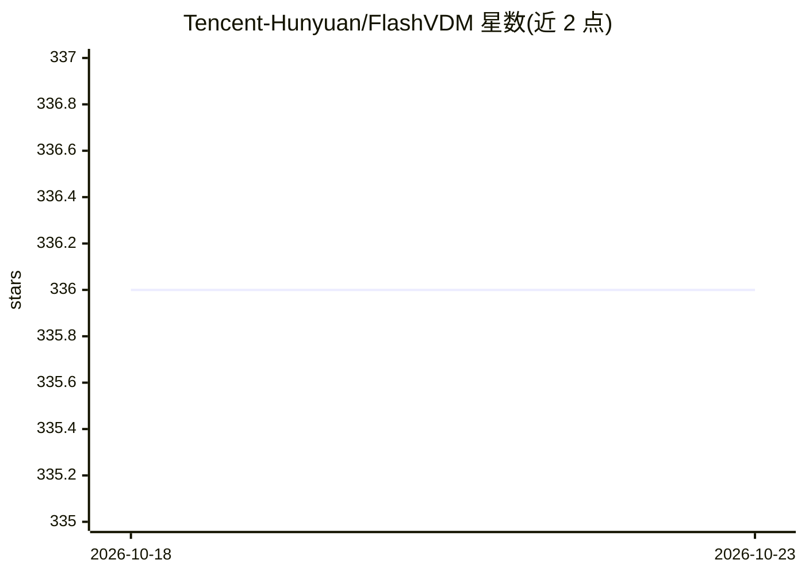

# Tencent-Hunyuan/FlashVDM

⭐ 336 · Python · NOASSERTION · 推送 2026-03-13 · [GitHub](https://github.com/Tencent-Hunyuan/FlashVDM) · 组织维护 · 中文 README

**加速 Vecset 扩散模型 3D 形状生成的通用框架**

腾讯混元团队开源的 Vecset Diffusion Model（VDM）加速通用框架，面向 Hunyuan3D-2、TripoSG、CraftsMan3D 等 3D 形状生成模型的推理提速。核心机制有二：Lightning Vecset Decoder 降低解码 FLOPs（宣称超 45 倍加速）；Progressive Flow Distillation 使扩散采样可少至 5 步推理。官方支持 Hunyuan3D-2 系列五个模型，另收录 HoloPart、DetailGen3D 等社区支持模型。README 未给出独立安装命令，使用需经由 Hunyuan3D-2 仓库集成（hy3dgen 管线调用）。论文被 ICCV 2025 接收为 highlight。

## 筛选速览

| 维度 | 判定 | 备注 |
|---|---|---|
| AI 角色 | `ai-ecosystem` | LLM/agent 周边工具 |
| 许可风险 | `none` | NOASSERTION |
| 部署形态 | `None` |  |
| 模型依赖 | — | README 未给出锁定关系 |
| 硬件要求 | — | 无带数字的原话,不猜 |
| 安装摩擦 | `low` | 无编译、无系统依赖或容器化 |
| 成熟度 | — | 结构信号不足 |

## 能力要点

- Lightning Vecset Decoder：降低解码 FLOPs，宣称超 45 倍加速
- Progressive Flow Distillation：扩散采样可少至 5 步推理
- 官方支持 Hunyuan3D-2/2mini/2mv/2.1/Omni 五个模型
- 社区支持 HoloPart、TripoSG、DetailGen3D、Step1X-3D 等模型

## 适用场景

- 给 Hunyuan3D 系列 3D 生成管线做推理加速
- 在 4090 上实现 1 秒内的形状生成
- 为其他 Vecset 扩散模型接入加速技术

## 场景标签

`推理引擎` · 领域:训练与推理

## 证据(README 行号)

> L12: FlashVDM is a general framework for accelerating shape generation Vecset Diffusion Model (VDM), such as Hunyuan3D-2
> L14: It features two techniques for both VAE and DiT acceleration:

## 星数曲线

2026-10-18 336 → 2026-10-23 336（+0）

---
*卡片 v1 · prompt 1.4 · 生成 2026-10-21 · 置信度 high · 依据 README sha `b7643dafeb5f` · [字段定义](../../DATASET.md)*
