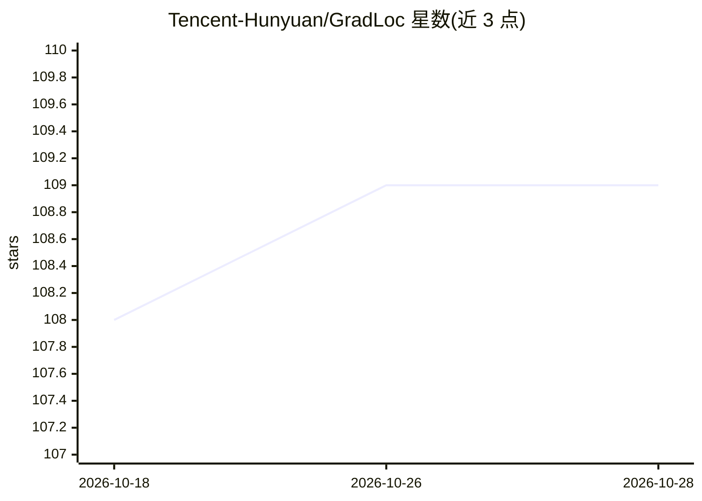

# Tencent-Hunyuan/GradLoc

⭐ 109 · Python · NOASSERTION · 推送 2026-02-16 · [GitHub](https://github.com/Tencent-Hunyuan/GradLoc) · [官网](https://hy.tencent.com/research/100015?langVersion=en) · 组织维护 · 中文 README

**RLVR 训练崩溃诊断的 verl 补丁：定位梯度尖峰元凶 token**

腾讯混元博客《Stabilizing RLVR via Token-level Gradient Diagnosis and Layerwise Clipping》中 GradLoc 部分的实现，形式为基于固定 verl commit（f9c855f）的补丁包。功能是以分布式二分搜索（O(log N)）将梯度尖峰定位到具体 token，定位路径为 global→micro-batch→rank→token，并通过阈值、搜索预算、输出目录等运行参数控制。使用方式：克隆上游 verl、在线或离线应用补丁后运行 run_experiment.sh；补丁改动涉及 ray_trainer.py、dp_actor.py 等四个文件。仓库自述为轻量补丁导向，未来计划打包为更完善的功能。

## 筛选速览

| 维度 | 判定 | 备注 |
|---|---|---|
| AI 角色 | `ai-ecosystem` | LLM/agent 周边工具 |
| 许可风险 | `none` | NOASSERTION |
| 部署形态 | `None` |  |
| 模型依赖 | — | README 未给出锁定关系 |
| 硬件要求 | — | 无带数字的原话,不猜 |
| 安装摩擦 | `low` | 无编译、无系统依赖或容器化 |
| 成熟度 | `idea` | |

## 能力要点

- 分布式二分搜索将梯度尖峰定位到具体 token（O(log N)）
- 定位路径 global→micro-batch→rank→token，带自适应阈值
- 以补丁形式作用于上游 verl 固定 commit，可在线/离线应用
- 提供补丁再生成脚本 make_patch.sh

## 适用场景

- RLVR 训练出现梯度尖峰/崩溃时定位问题 token
- 在自有 verl 环境中复现博客实验
- 基于补丁二次开发并重新生成补丁

## 场景标签

`强化学习` · 领域:训练与推理

## 证据(README 行号)

> L23: This repository implements the **GradLoc** part from our blog on RLVR training collapse diagnosis and stabilization
> L32: This repo is intentionally lightweight and patch-oriented, so you can directly apply changes to upstream `verl` and

## 星数曲线

2026-10-18 108 → 2026-10-28 109（+1）

---
*卡片 v1 · prompt 1.4 · 生成 2026-10-23 · 置信度 high · 依据 README sha `2c5a68ee1c0d` · [字段定义](../../DATASET.md)*
