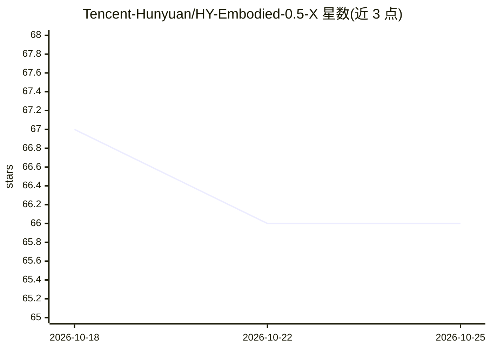

# Tencent-Hunyuan/HY-Embodied-0.5-X

⭐ 66 · Python · NOASSERTION · 推送 2026-05-14 · [GitHub](https://github.com/Tencent-Hunyuan/HY-Embodied-0.5-X) · [官网](https://tairos.tencent.com/openSourceModels/hy-embodied) · 组织维护 · 中文 README

**腾讯开源的具身智能多模态基础模型，面向真实机器人理解-推理-行动**

腾讯 Robotics X 与 HY Vision Team 联合发布的具身多模态基础模型，基于 HY-Embodied-0.5 MoT-2B 架构（总参数 4B、激活 2B），面向真实机器人交互的核心循环，提供空间理解、长程任务规划、动作预测、风险判断与失败反思等能力，并给出推理与 SFT 训练代码。数据由自采第一人称机器人操作数据、机械臂数据与开源具身数据构成，核心样本带 CoT 标注。支持单图推理 CLI、Python API 与 OpenAI 兼容 API 服务；训练提供单卡（≥16GB 显存）与 DeepSpeed ZeRO-2 多卡两种配置，单卡冒烟测试无需 torchrun。运行需 Linux、Python 3.12、CUDA 12.6，权重从 HuggingFace 下载。许可为 Apache-2.0。

## 筛选速览

| 维度 | 判定 | 备注 |
|---|---|---|
| AI 角色 | `ai-native` | 本体是模型或模型工具 |
| 许可风险 | `none` | NOASSERTION |
| 部署形态 | `library` | 以包/库形式分发 |
| 模型依赖 | — | README 未给出锁定关系 |
| 硬件要求 | `gpu-8g` | |
| 安装摩擦 | `medium` | 含编译或系统依赖之一 |
| 成熟度 | — | 结构信号不足 |

## 能力要点

- MoT-2B 架构：4B 总参数、仅 2B 激活，面向边缘侧部署
- 提供推理 CLI、Python API 与 OpenAI 兼容 /v1/chat/completions 服务
- SFT 训练代码含单卡与 DeepSpeed ZeRO-2 多卡配置，附 14 条示例数据可端到端跑通
- 输出支持 Point/Box 坐标（归一化到 0-1000）与 think/answer 结构化思考模式

## 适用场景

- 家庭服务/桌面操作场景下做空间推理与操作任务理解
- 仿真环境中做具身任务规划评测与多模态交互研究
- 本地部署验证具身能力并做下游 SFT 微调

## 场景标签

`多模态` `微调` · 领域:感知与多模态

## 证据(README 行号)

> L14: **HY-Embodied-0.5-X** is an enhanced open-source embodied multimodal foundation model
> L17: only 2B activated), it is specifically optimized for the core loop of
> L24: real-world robot interaction, with dedicated improvements in **fine-grained

## 星数曲线

2026-10-18 67 → 2026-10-25 66（-1）

---
*卡片 v1 · prompt 1.4 · 生成 2026-10-24 · 置信度 mid · 依据 README sha `93f4068d64dc` · [字段定义](../../DATASET.md)*
