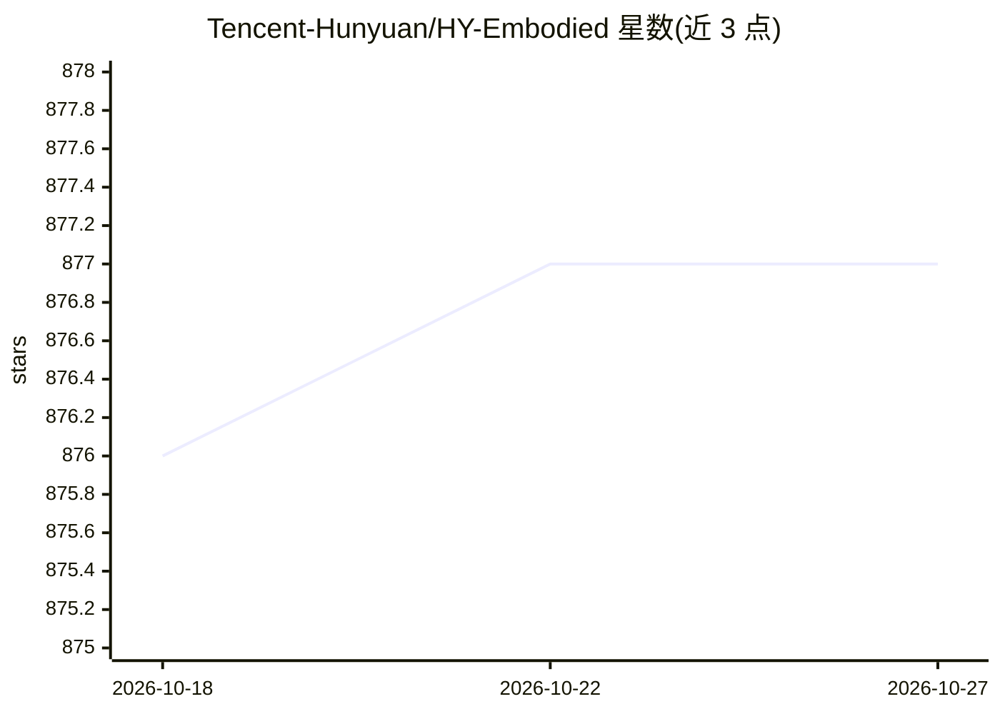

# Tencent-Hunyuan/HY-Embodied

⭐ 877 · Python · NOASSERTION · 推送 2026-07-15 · [GitHub](https://github.com/Tencent-Hunyuan/HY-Embodied) · 组织维护 · 中文 README

**面向物理世界具身智能体的视觉-语言基础模型及推理代码**

腾讯 Robotics X 等团队发布的具身智能基础模型系列仓库：Hy-Embodied-VLM-1.0 为约 30B 参数的 MoE 视觉-语言模型（每 token 激活约 3B），结合 Hy3-A3B 语言骨干与 Hy-ViT2 视觉编码器，提供 transformers 与 vLLM（含 in-tree 插件）两条推理路径，支持 enable_thinking 混合推理模式切换；权重托管于 Hugging Face，首跑自动下载（约 120GB 磁盘）。面向具身智能研究者与开发者；完整 BF16 推理推荐单节点 8×80GB GPU；微调代码与在线 Demo 尚未发布。

## 筛选速览

| 维度 | 判定 | 备注 |
|---|---|---|
| AI 角色 | `ai-native` | 本体是模型或模型工具 |
| 许可风险 | `none` | NOASSERTION |
| 部署形态 | `library` | 以包/库形式分发 |
| 模型依赖 | local-ok | 支持本地模型 |
| 硬件要求 | — | 无带数字的原话,不猜 |
| 安装摩擦 | `medium` | 含编译或系统依赖之一 |
| 成熟度 | — | 结构信号不足 |

## 能力要点

- 约 30B 总参数、每 token 激活约 3B 的 MoE 架构
- 提供 transformers 单机推理与 vLLM 服务化推理（in-tree 插件）两条路径
- enable_thinking 混合推理模式（同一权重内按请求切换）
- 仓库同时包含 HY-VLA-0.5 与 Hy-Embodied-0.5 MoT-2B 的代码与权重

## 适用场景

- 在机器人或具身智能任务中部署视觉-语言基础模型做感知与推理
- 用 vLLM 起 OpenAI 兼容端点服务该模型
- 在 38 个具身相关基准上复现或对比评测结果

## 场景标签

`多模态` · 领域:感知与多模态

## 证据(README 行号)

> L12:  * **`[2026-07-15]`** 🚀 We have released **Hy-Embodied-VLM-1.0**! An efficient Mixture-of-Experts vision–language f
> L18: Building capable embodied agents requires not only multimodal perception and understanding, but also agentic capabi
> L22: To deliver strong physical-world understanding and interaction capabilities while supporting latency-sensitive depl

## 星数曲线

2026-10-18 876 → 2026-10-27 877（+1）

---
*卡片 v1 · prompt 1.4 · 生成 2026-10-21 · 置信度 high · 依据 README sha `7eed4e5ec67f` · [字段定义](../../DATASET.md)*
