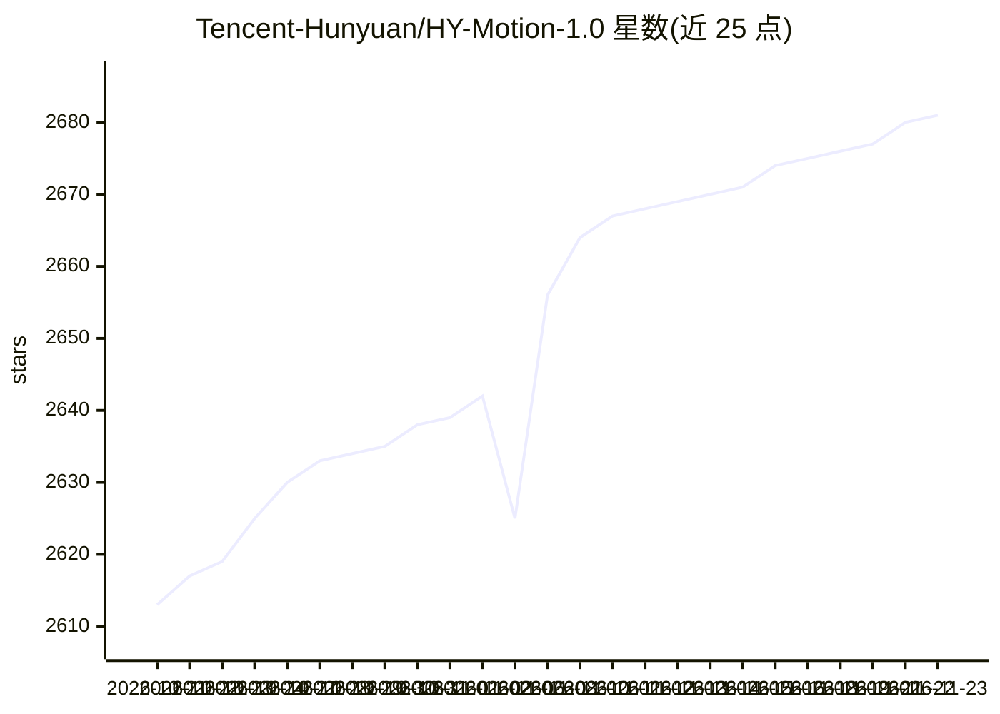

# Tencent-Hunyuan/HY-Motion-1.0

⭐ 2,681 · Python · NOASSERTION · 推送 2026-11-13 · [GitHub](https://github.com/Tencent-Hunyuan/HY-Motion-1.0) · [官网](https://hunyuan.tencent.com/motion) · 组织维护 · 中文 README

**文本生成3D人体骨骼动画的模型库：开发者输入文字即得动作**

腾讯混元发布的文本到3D人体动作生成模型系列，基于 DiT 与 Flow Matching，从文字提示生成骨架驱动的角色动画，可接入 3D 动画管线。提供 1.0B 标准版与 0.46B Lite 版，训练数据覆盖 3000+ 小时动作。本地推理最低需 24-26GB 显存，支持 CLI 批量推理与本地 Gradio 界面；内置 LLM 提示词改写与时长估计模块，可禁用。仅支持人形角色，不支持多人、动物、场景与镜头描述。

## 筛选速览

| 维度 | 判定 | 备注 |
|---|---|---|
| AI 角色 | `ai-native` | 本体是模型或模型工具 |
| 许可风险 | `none` | NOASSERTION |
| 部署形态 | `library` | 以包/库形式分发 |
| 模型依赖 | — | README 未给出锁定关系 |
| 硬件要求 | — | 无带数字的原话,不猜 |
| 安装摩擦 | `low` | 无编译、无系统依赖或容器化 |
| 成熟度 | — | 结构信号不足 |

## 能力要点

- 1.0B 与 0.46B 两个尺寸的文本生成动作模型，最低 24GB 显存运行
- CLI 批量推理脚本与本地 Gradio 可视化界面
- 可选 LLM 提示词改写与时长估计模块（可禁用）
- 三阶段训练：大规模预训练、高质量微调、人类反馈强化学习

## 适用场景

- 从文字描述生成骨骼动画供 3D 管线使用
- 本地批量推理大量文本提示生成动作序列
- 通过 ComfyUI 集成到现有工作流

## 场景标签

`视频生成` · 领域:内容生成

## 证据(README 行号)

> L32: **HY-Motion 1.0** is a series of text-to-3D human motion generation models based on Diffusion Transformer (DiT) and
> L67: HY-Motion 1.0 supports macOS, Windows, and Linux.

## 星数曲线

2026-10-21 2,613 → 2026-11-23 2,681（+68）

---
*卡片 v1 · prompt 1.4 · 生成 2026-11-23 · 置信度 high · 依据 README sha `6cb5ae7708ca` · [字段定义](../../DATASET.md)*
