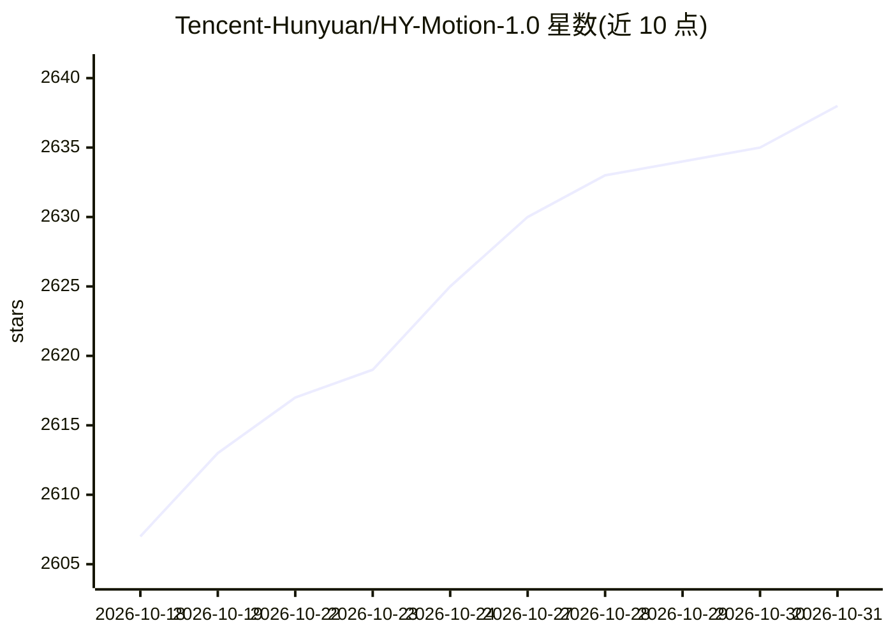

# Tencent-Hunyuan/HY-Motion-1.0

⭐ 2,638 · Python · NOASSERTION · 推送 2026-07-18 · [GitHub](https://github.com/Tencent-Hunyuan/HY-Motion-1.0) · [官网](https://hunyuan.tencent.com/motion) · 组织维护 · 中文 README

**腾讯混元的文本生成 3D 人体动作模型系列**

基于 Diffusion Transformer 与 Flow Matching 的 text-to-motion 模型系列，含 1.0B 标准版与 0.46B Lite 版（最低 VRAM 分别为 26GB/24GB），从文本提示生成骨架级 3D 角色动画，可接入 3D 动画管线。采用大规模预训练（3000+ 小时动作数据）、高质量微调（400 小时）与基于人类反馈的强化学习三阶段训练。提供 CLI 批量推理脚本与本地 Gradio 网页界面，支持 macOS/Windows/Linux；可选 LLM 驱动的时长估计与提示词改写模块（可禁用）。不支持非人形角色、多人交互、环境与镜头描述等场景。

## 筛选速览

| 维度 | 判定 | 备注 |
|---|---|---|
| AI 角色 | `ai-native` | 本体是模型或模型工具 |
| 许可风险 | `none` | NOASSERTION |
| 部署形态 | `library` | 以包/库形式分发 |
| 模型依赖 | — | README 未给出锁定关系 |
| 硬件要求 | — | 无带数字的原话,不猜 |
| 安装摩擦 | `low` | 无编译、无系统依赖或容器化 |
| 成熟度 | — | 结构信号不足 |

## 能力要点

- 文本生成骨架级 3D 人体动作，1.0B 与 0.46B 两个模型版本
- 三阶段训练：3000+ 小时预训练 + 400 小时微调 + RLHF 强化学习
- 提供 CLI 批量推理与本地 Gradio 交互界面
- 发布 SSAE 评测提示与代码（VLM 语义对齐度指标）

## 适用场景

- 从文本提示批量生成 3D 角色动画用于动画管线
- 在本地 Gradio 界面交互式预览生成的动作
- 评估生成视频与文本语义对齐程度

## 场景标签

 · 领域:3D 内容生成/角色动画

## 证据(README 行号)

> L31: **HY-Motion 1.0** is a series of text-to-3D human motion generation models based on Diffusion Transformer (DiT) and
> L21: # HY-Motion 1.0: Scaling Flow Matching Models for 3D Motion Generation

## 星数曲线

2026-10-18 2,607 → 2026-10-31 2,638（+31）

---
*卡片 v1 · prompt 1.4 · 生成 2026-10-21 · 置信度 mid · 依据 README sha `f059772e0c9b` · [字段定义](../../DATASET.md)*
