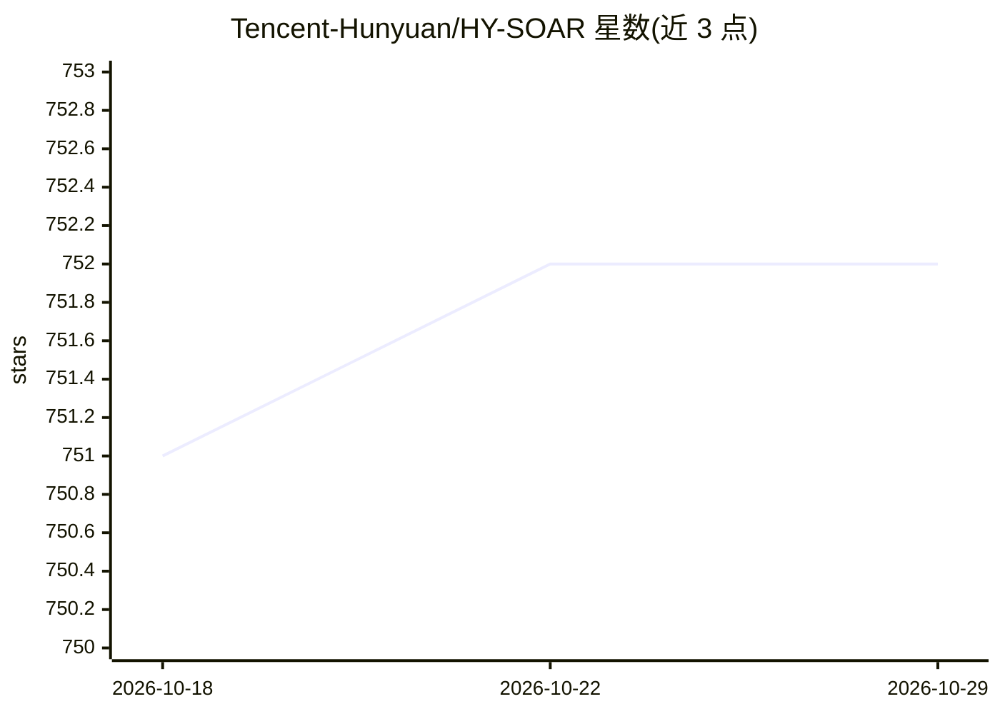

# Tencent-Hunyuan/HY-SOAR

⭐ 752 · Python · NOASSERTION · 推送 2026-04-21 · [GitHub](https://github.com/Tencent-Hunyuan/HY-SOAR) · 组织维护 · 中文 README

**扩散模型的无奖励后训练方法：生成时自我纠错**

腾讯混元开源的 rectified-flow 扩散模型后训练方法（SOAR），针对去噪轨迹中的曝光偏差：在误差发生的时间步用解析纠错目标监督去噪器，无需奖励模型、偏好标签或负样本。训练基于 stable-diffusion-3.5-medium，默认单机 8 GPU、全局 batch 32，支持 GenEval/OCR/PickScore 等奖励模型用于评测，提供训练与评测代码及 DrawBench 基准结果。

## 筛选速览

| 维度 | 判定 | 备注 |
|---|---|---|
| AI 角色 | `ai-ecosystem` | LLM/agent 周边工具 |
| 许可风险 | `none` | NOASSERTION |
| 部署形态 | `library` | 以包/库形式分发 |
| 模型依赖 | — | README 未给出锁定关系 |
| 硬件要求 | — | 无带数字的原话,不猜 |
| 安装摩擦 | `low` | 无编译、无系统依赖或容器化 |
| 成熟度 | — | 结构信号不足 |

## 能力要点

- 无奖励模型、无偏好标签的稠密每时间步纠错训练信号
- 基于 DiffusionNFT 与 Flow-GRPO 代码库实现
- 默认单机 8 GPU 训练配置，DeepSpeed ZeRO-2 + bf16
- 提供 DrawBench/GenEval/OCR 等评测与分布式推理脚本

## 适用场景

- 对文生图扩散模型做替代 SFT 的第一阶段后训练
- 在不引入奖励模型的前提下缓解去噪轨迹误差累积
- 在 GenEval/OCR/PickScore 等基准上评测对齐效果

## 场景标签

`微调` · 领域:训练与推理

## 证据(README 行号)

> L15: **HY-SOAR** (Self-Correction for Optimal Alignment and Refinement) is a reward-free post-training method for rectif
> L55:  - [x] Training code

## 星数曲线

2026-10-18 751 → 2026-10-29 752（+1）

---
*卡片 v1 · prompt 1.4 · 生成 2026-10-21 · 置信度 mid · 依据 README sha `66ad83f6f54a` · [字段定义](../../DATASET.md)*
