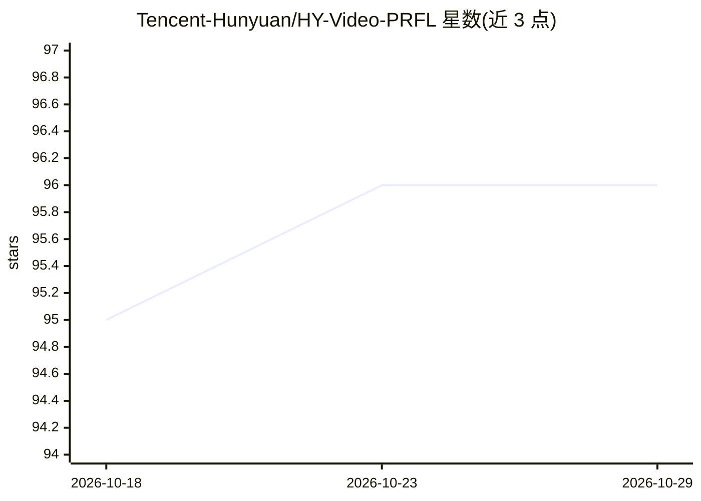

# Tencent-Hunyuan/HY-Video-PRFL

⭐ 96 · Python · NOASSERTION · 推送 2026-01-13 · [GitHub](https://github.com/Tencent-Hunyuan/HY-Video-PRFL) · 组织维护 · 中文 README

**视频生成模型隐空间过程奖励反馈学习（PRFL）训练与推理代码**

腾讯混元发布的 HY-Video-PRFL：提出 Process Reward Feedback Learning（PRFL）框架，将预训练视频生成模型用作噪声隐空间中的奖励模型，无需 VAE 解码即可在全去噪链路上做梯度回传的偏好优化。仓库提供 PAVRM 与 PRFL 的训练和推理代码，基于 Wan2.1-14B 模型（T2V/I2V、480P/720P），支持多卡 torchrun 并行、LoRA、FSDP、teacache 与 CPU offload。要求 Linux、CUDA 12.4，README 推荐至少 80GB 显存的 GPU；14B 模型 720P×81 帧后训练可在 67GB 显存内完成。面向视频生成后训练的研究与工程用户。

## 筛选速览

| 维度 | 判定 | 备注 |
|---|---|---|
| AI 角色 | `ai-native` | 本体是模型或模型工具 |
| 许可风险 | `none` | NOASSERTION |
| 部署形态 | `library` | 以包/库形式分发 |
| 模型依赖 | — | README 未给出锁定关系 |
| 硬件要求 | `gpu-24g` | |
| 安装摩擦 | `medium` | 含编译或系统依赖之一 |
| 成熟度 | — | 结构信号不足 |

## 能力要点

- 隐空间全程梯度回传的 PRFL 偏好优化，无需 VAE 解码
- 提供 PAVRM 与 PRFL 的训练与推理代码，覆盖 T2V/I2V、480P/720P
- 支持多卡 torchrun 并行、FSDP、LoRA、teacache 加速与 CPU offload
- 14B 模型 720P×81 帧后训练可在 67GB 显存内完成

## 适用场景

- 对 Wan2.1 视频生成模型做人类偏好对齐后训练
- 训练视频奖励模型并用于视频质量评估
- 研究隐空间奖励反馈学习与传统 RGB ReFL 的效率差异

## 场景标签

`视频生成` `微调` · 领域:内容生成

## 证据(README 行号)

> L7: Video generation models can both create and evaluate — we enable 14B models to complete full 720P×81-frame post-trai
> L35: **HY-Video-PRFL** introduces **Process Reward Feedback Learning (PRFL)**, a framework that conducts preference opti
> L121: |**Wan2.1-T2V-14B**|480P & 720P|🤗 Huggingface 🤖 ModelScope|Text-to-Video model|

## 星数曲线

2026-10-18 95 → 2026-10-29 96（+1）

---
*卡片 v1 · prompt 1.4 · 生成 2026-10-23 · 置信度 mid · 依据 README sha `252aed35ea6d` · [字段定义](../../DATASET.md)*
