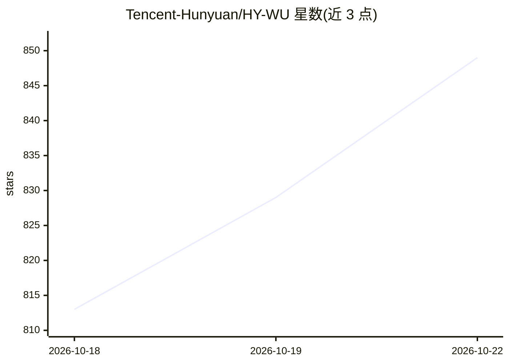

# Tencent-Hunyuan/HY-WU

⭐ 847 · Python · NOASSERTION · 推送 2026-03-18 · [GitHub](https://github.com/Tencent-Hunyuan/HY-WU) · 组织维护 · 中文 README

**为文本引导图像编辑即时生成 LoRA 适配器的神经记忆框架**

腾讯混元团队开源的研究框架与模型权重：HY-WU 在推理时根据图像与指令的混合表征即时合成实例条件的 LoRA 适配器权重，注入冻结骨干模型的前向传播，无需测试时微调即可实现文本引导图像编辑，展示例包括服装融合、换装试穿与人脸身份迁移。基于 HY-Image-3.0-Instruct 检查点，提供 infer.py 与 Gradio 网页界面；80B 骨干（13B 激活）+8B HY-WU 参数推荐 8×40GB 或 4×80GB 显存，需多卡推理。附 arXiv 论文引用条目。

## 筛选速览

| 维度 | 判定 | 备注 |
|---|---|---|
| AI 角色 | `ai-native` | 本体是模型或模型工具 |
| 许可风险 | `none` | NOASSERTION |
| 部署形态 | `library` | 以包/库形式分发 |
| 模型依赖 | — | README 未给出锁定关系 |
| 硬件要求 | — | 无带数字的原话,不猜 |
| 安装摩擦 | `low` | 无编译、无系统依赖或容器化 |
| 成熟度 | — | 结构信号不足 |

## 能力要点

- 按请求即时生成实例条件 LoRA 适配器，无需测试时微调
- 结构化参数分词方式兼容大规模架构（README 称至 80B 参数）
- 提供推理代码、HY-Image-3.0-Instruct 检查点与 Gradio 交互界面
- 蒸馏检查点与其他模型检查点在开源计划中尚未发布

## 适用场景

- 文本引导的图像编辑（换装、试穿、身份迁移、纹理合成）
- 研究免微调的条件参数生成与神经记忆机制
- 基于实例条件适配器做图像个性化生成实验

## 场景标签

`图像生成` · 领域:内容生成

## 证据(README 行号)

> L16: We propose HY-WU: a scalable framework for on-the-fly conditional generation of low-rank (LoRA) updates.
> L17: HY-WU synthesizes instance-conditioned adapter weights from hybrid image–instruction representations and injects th

## 星数曲线

2026-10-18 813 → 2026-10-22 849（+36）

---
*卡片 v1 · prompt 1.4 · 生成 2026-10-21 · 置信度 mid · 依据 README sha `4a8010009fe4` · [字段定义](../../DATASET.md)*
