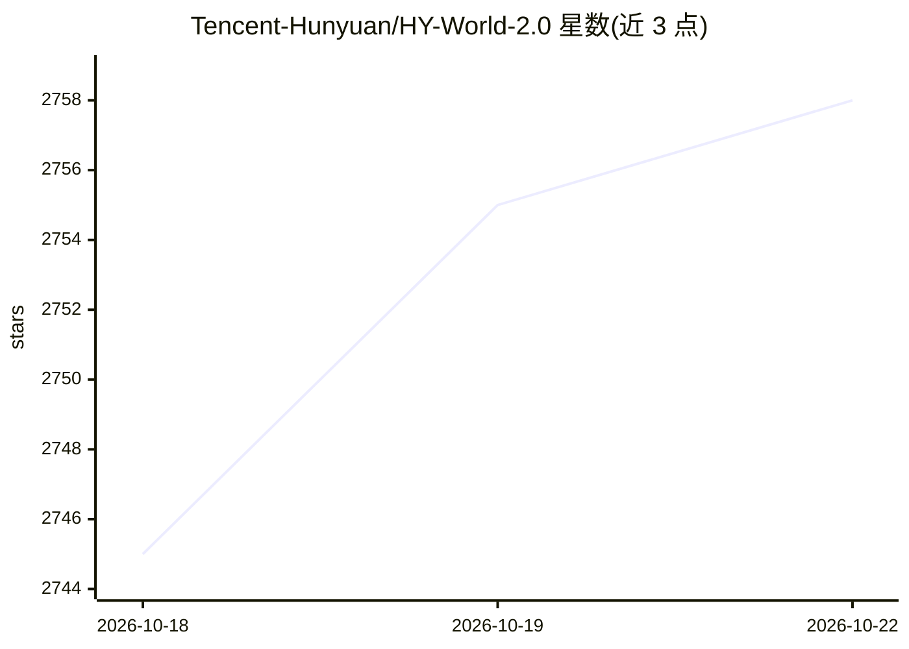

# Tencent-Hunyuan/HY-World-2.0

⭐ 2,761 · Python · NOASSERTION · 推送 2026-08-12 · [GitHub](https://github.com/Tencent-Hunyuan/HY-World-2.0) · [官网](https://3d-models.hunyuan.tencent.com/world/) · 组织维护 · 中文 README

**腾讯混元多模态世界模型：从文本/图像/视频生成与重建 3D 世界**

HY-World 2.0 是腾讯混元开源的多模态世界模型框架，含两大能力：世界生成（文本/单图经全景生成 HY-Pano 2.0、轨迹规划 WorldNav、世界扩展 WorldStereo 2.0、世界合成 WorldMirror 2.0 四阶段输出可漫游的 3DGS/mesh 场景）与世界重建（多视图图像/视频经前馈模型 WorldMirror 2.0 单次前向预测深度、法线、相机参数、点云与 3DGS）。输出可导入 Blender/Unity/Unreal/Isaac Sim，并提供 Gradio 网页演示。限制：模型规模大（HY-Pano-2 约 80B），推荐 CUDA 12.8 与 Python 3.11+，多 GPU 模式下输入图像数须不少于 GPU 数。

## 筛选速览

| 维度 | 判定 | 备注 |
|---|---|---|
| AI 角色 | `ai-native` | 本体是模型或模型工具 |
| 许可风险 | `none` | NOASSERTION |
| 部署形态 | `library` | 以包/库形式分发 |
| 模型依赖 | — | README 未给出锁定关系 |
| 硬件要求 | — | 无带数字的原话,不猜 |
| 安装摩擦 | `medium` | 含编译或系统依赖之一 |
| 成熟度 | — | 结构信号不足 |

## 能力要点

- 四阶段世界生成管线输出 3DGS/mesh 资产
- WorldMirror 2.0 单次前向同时预测深度/法线/相机/点云/3DGS
- diffusers 风格 Python API，权重首次运行自动下载
- 提供 Gradio 交互式 Web 演示与 CLI/多 GPU 推理

## 适用场景

- 从文本或单张图像生成可漫游、可编辑的 3D 场景
- 用手机视频或多视图照片重建数字孪生
- 为游戏引擎（Unity/Unreal/Isaac Sim）生成可导入的 3D 资产

## 场景标签

`多模态` · 领域:感知与多模态

## 证据(README 行号)

> L24: **HY-World 2.0** is a multi-modal world model framework for **world generation** and **world reconstruction**. It a
> L26: - **World Generation** (text / single image &rarr; 3D world): syntheses high-fidelity, navigable 3D scenes through 
> L27: - **World Reconstruction** (multi-view images / video &rarr; 3D): Powered by WorldMirror 2.0, a unified feed-forwar

## 星数曲线

2026-10-18 2,745 → 2026-10-22 2,758（+13）

---
*卡片 v1 · prompt 1.4 · 生成 2026-10-21 · 置信度 high · 依据 README sha `0c0581e60bda` · [字段定义](../../DATASET.md)*
