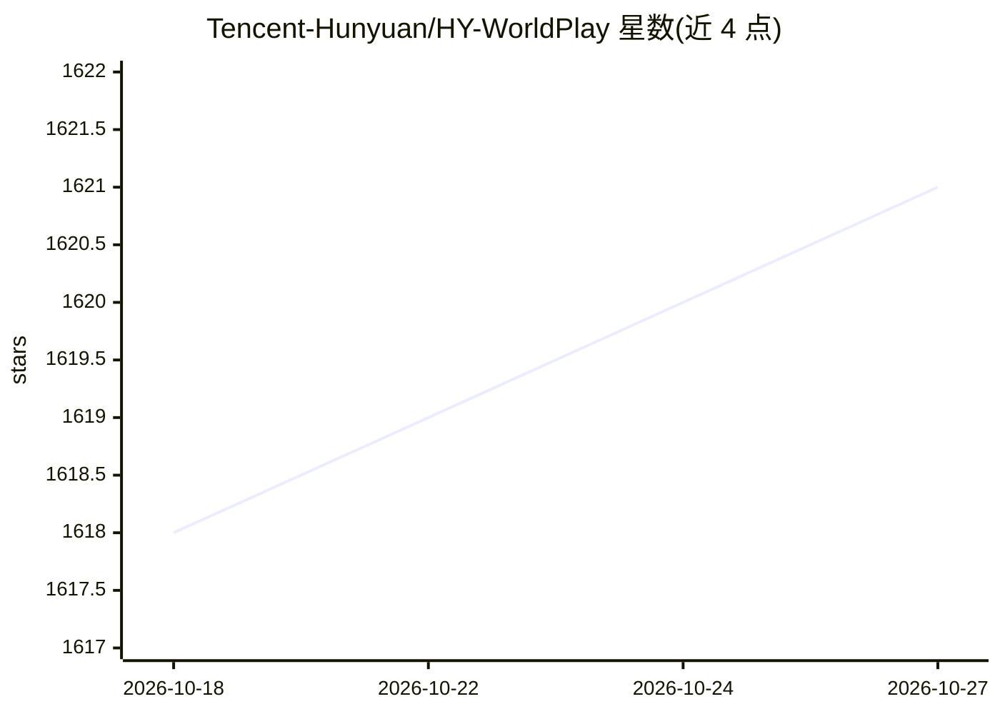

# Tencent-Hunyuan/HY-WorldPlay

⭐ 1,621 · Python · NOASSERTION · 推送 2026-06-10 · [GitHub](https://github.com/Tencent-Hunyuan/HY-WorldPlay) · [官网](https://3d-models.hunyuan.tencent.com/world/) · 组织维护 · 中文 README

**腾讯开源的实时交互式世界模型：动作驱动的流式视频生成**

HY-World 1.5（WorldPlay）是流式视频扩散世界模型：以单张图片或文本描述世界，根据用户键鼠动作逐块（16帧）预测生成未来视频，实现 24 FPS 实时交互与长期几何一致性。技术机制包括双动作表示、重构上下文记忆、WorldCompass RL 后训练与 Context Forcing 蒸馏。开源训练与推理代码，提供 5 个模型检查点（含轻量 WAN-5B 版本），推理需 NVIDIA CUDA GPU（28G-72G 显存，视并行度而定），并有在线 demo。

## 筛选速览

| 维度 | 判定 | 备注 |
|---|---|---|
| AI 角色 | `ai-native` | 本体是模型或模型工具 |
| 许可风险 | `none` | NOASSERTION |
| 部署形态 | `library` | 以包/库形式分发 |
| 模型依赖 | local-ok | 支持本地模型 |
| 硬件要求 | — | 无带数字的原话,不猜 |
| 安装摩擦 | `medium` | 含编译或系统依赖之一 |
| 成熟度 | — | 结构信号不足 |

## 能力要点

- 动作条件下的逐块（16帧）流式视频生成，24 FPS 实时推理
- 重构上下文记忆与 Context Forcing 蒸馏保持长期几何一致性
- 开源 WorldPlay-8B 训练/微调代码与 RL 后训练框架 WorldCompass
- 提供轻量 WAN-5B 版本适配小显存 GPU

## 适用场景

- 从单张图片或文本生成可交互漫游的 3D 世界视频
- 研究世界模型的训练、RL 后训练与蒸馏全流程
- 在自有数据上训练微调定制世界模型

## 场景标签

`视频生成` `微调` · 领域:内容生成

## 证据(README 行号)

> L30: While **HY-World 1.0** is capable of generating immersive 3D worlds, it relies on a lengthy offline generation proc
> L40:  Given a single image or text prompt to describe a world, our model performs a next chunk (16 video frames) predict
> L44: - **GPU**: NVIDIA GPU with CUDA support

## 星数曲线

2026-10-18 1,618 → 2026-10-27 1,621（+3）

---
*卡片 v1 · prompt 1.4 · 生成 2026-10-21 · 置信度 high · 依据 README sha `92e040d814d8` · [字段定义](../../DATASET.md)*
