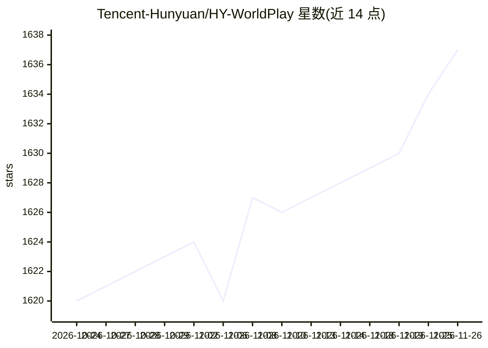

# Tencent-Hunyuan/HY-WorldPlay

⭐ 1,637 · Python · NOASSERTION · 推送 2026-11-25 · [GitHub](https://github.com/Tencent-Hunyuan/HY-WorldPlay) · [官网](https://3d-models.hunyuan.tencent.com/world/) · 组织维护 · 中文 README

**腾讯开源的实时交互式 3D 世界模型，输入图像/文本生成可操作视频**

腾讯混元发布的 HY-World 1.5（WorldPlay），一个流式视频扩散世界模型：给定单张图像或文本提示，按用户键盘/鼠标动作逐块（每块 16 帧）预测生成未来视频，以 24 FPS 输出。核心机制包括双动作表示、重建上下文记忆（Reconstituted Context Memory）、WorldCompass 强化学习后训练与 Context Forcing 蒸馏。README 提供完整训练与推理框架：conda/pip 安装、模型下载脚本、四类检查点（双向/自回归/RL/蒸馏）、HunyuanVideo 与 WAN 双推理管线；推理需 28–72G 显存（依并行度）。

## 筛选速览

| 维度 | 判定 | 备注 |
|---|---|---|
| AI 角色 | `ai-native` | 本体是模型或模型工具 |
| 许可风险 | `none` | NOASSERTION |
| 部署形态 | `library` | 以包/库形式分发 |
| 模型依赖 | local-ok | 支持本地模型 |
| 硬件要求 | — | 无带数字的原话,不猜 |
| 安装摩擦 | `medium` | 含编译或系统依赖之一 |
| 成熟度 | — | 结构信号不足 |

## 能力要点

- 给定单图或文本，按键盘/鼠标动作实时生成 24 FPS 流式视频
- 重建上下文记忆维持长时程几何一致性
- 提供 HunyuanVideo（8B）与 WAN（5B 轻量低显存）双推理管线及 RL 后训练代码
- 支持一/三人称视角与自定义 JSON 相机轨迹

## 适用场景

- 从单张图像生成可交互探索的 3D 场景视频
- 训练/微调自己的交互式世界模型
- 游戏或模拟场景中的无限世界扩展与可控事件生成
- 基于生成视频做 3D 重建

## 场景标签

`视频生成` · 领域:内容生成

## 证据(README 行号)

> L18: - December 17, 2025: 🤗 We release the first open-source, real-time interactive, and long-term geometric consistent 
> L30: While **HY-World 1.0** is capable of generating immersive 3D worlds, it relies on a lengthy offline generation proc
> L40:  Given a single image or text prompt to describe a world, our model performs a next-chunk (16 video frames) predict

## 星数曲线

2026-10-24 1,620 → 2026-11-26 1,637（+17）

---
*卡片 v1 · prompt 1.4 · 生成 2026-11-26 · 置信度 high · 依据 README sha `f0941e0e7791` · [字段定义](../../DATASET.md)*
